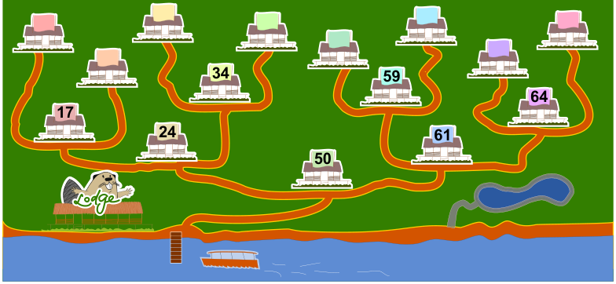

Milo arbeitet in einer Ferienhaus-Siedlung. Einige Ferienhäuser haben noch keine Nummern. Eines davon soll die neue Nummer 29 bekommen. Das soll Milo erledigen.

Milo startet bei Haus 50. Von einem Haus mit Nummer geht er

- nach links, wenn dessen Nummer größer ist als die neue Nummer.
- nach rechts, wenn dessen Nummer kleiner ist als die neue Nummer.

Sobald er zu einem Haus ohne Nummer gelangt, bekommt dieses die neue Nummer 29.

**Welches Ferienhaus bekommt die Nummer 29?**

Klicke auf das richtige Haus.
