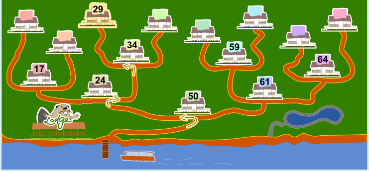

Das richtige Haus ist das dritte von links in der oberen Reihe (siehe Bild).

Die Nummer 50 des ersten Ferienhauses ist größer als die neue Ferienhausnummer 29; also muss Milo als erstes nach links gehen. Als nächstes erreicht er das Haus mit der Nummer 24. Da 24 kleiner 29, geht Milo nun nach rechts. Die Nummer 34 des nächsten Hauses ist wieder größer als die 29; deshalb geht er von dort nach links. Nun gelangt er zu einem Haus ohne Nummer. Dieses Ferienhaus bekommt die Nummer 29.

## Das ist Informatik!

Die Ferienhäuser in dieser Biberaufgabe sind wie in einem binären Suchbaum angeordnet und nummeriert. Diese Datenstruktur wird in der Informatik häufig genutzt. Mit einem binären Suchbaum kann man gespeicherte Daten schnell wiederfinden.

Ein binärer Suchbaum ist so aufgebaut: Er beginnt mit einer Verzweigung. An jeder Verzweigung („Knoten") ist ein „Element" gespeichert. Von jedem Knoten führen maximal zwei Wege („Kanten") zu weiteren Knoten. Beim Speichern neuer Elemente wird bei jedem Knoten stets der linke Weg eingeschlagen, wenn das neue Element einen kleineren Wert hat als das am Knoten selbst gespeicherte Element, sonst der rechte Weg. Das neue Element wird als Nachfolger des ersten Knotens gespeichert, von dem aus noch weniger als zwei Kanten ausgehen.

Bei der Suche nach einem Element kann man dann an jedem Knoten leicht entscheiden, welchen Weg man einschlagen muss. Wenn der binäre Suchbaum „balanciert" ist, muss man nach einem Schritt nur noch jeweils ungefähr die Hälfte der Kreuzungen durchsuchen. Das führt dazu, dass 1000 Elemente in nur 10 Schritten durchsucht werden können, 1.000.000 Elemente in 20 Schritten oder 1.000.000.000 Elemente in 30 Schritten (also bei *n* Elementen in log2 *n* Schritten).
