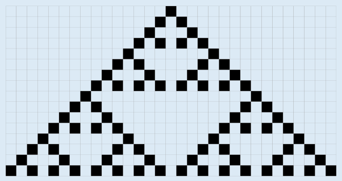

Hier ist die einfachste Regelmenge (bei der die wenigsten unteren Fliesen auf schwarz gesetzt sind), die in der untersten Reihe das gewünschte Muster erzeugt:

Mit dieser Regelmenge wird die Fläche so belegt:

Bei dieser Biberaufgabe gibt es mehrere richtige Antworten. Wir beschreiben eine Regelmenge durch die Farbwahl der unteren Fliesen und kodieren weiß mit 0 und schwarz mit 1. Die oben genannte Regelmenge wird dann mit 00010010 bezeichnet.

Hier sind alle 17 Regelmengen, die zu dem gewünschten Muster führen: 00010010, 00011010, 00110010, 00111010, 01010010, 01011010, 01110010, 01111010, 10010010, 10011010, 10110010, 10110011, 10111010, 11010010, 11011010, 11110010, 11111010

Weil es so viele richtige Antworten gibt, hat man gute Chancen, eine davon durch Ausprobieren zu finden. Wer genauer überlegt, wird sich zuerst die Regeln 4, 6 und 7 (von links gezählt) anschauen. Nur diese Regeln sind auf die einzelne schwarze Fliese in der ersten Reihe anwendbar. Bei mindestens einer dieser Regeln muss eine untere Fliese auf schwarz gesetzt werden, sonst sind in der nächsten Reihe alle Fliesen weiß, und das gewünschte Muster lässt sich nicht mehr erreichen. Bei Regel 6 wiederum darf die untere Fliese nicht auf schwarz gesetzt werden: Sonst wäre in jeder Reihe die mittlere Fliese schwarz, aber das ist im gewünschten Muster nicht der Fall. So kommt man schnell darauf, dass es genügt, in den Regeln 4 und 7 die untere Fliese auf schwarz zu setzen.

## Das ist Informatik!

Für das Verständnis der Möglichkeiten und Grenzen der Informatik spielen Automaten eine entscheidende Rolle – aber nicht etwa Kaffeeautomaten, wie Spötter behaupten mögen. In der Informatik sind Automaten formale Modelle von Berechnungsprozessen. Es gibt sehr viele verschiedene Arten von Automaten, alle mit unterschiedlichen Eigenschaften. Einer der berühmtesten Automaten ist die Turingmaschine, die ein umfassendes Modell aller berechenbaren Funktionen darstellt. Wie alle Automaten, liest sie nach und nach die „Buchstaben" (allgemeiner sagt man: Zeichen) eines Wortes ein und verändert in jedem Schritt ihren Zustand. Die Turingmaschine kann dabei selbst wieder Zeichen auf ein endloses Band schreiben.

Etwas anders funktionieren die sogenannten zellulären Automaten. In dieser Biberaufgabe geht es um elementare zelluläre Automaten, die nur aus einer Reihe von Zellen bestehen, mit je zwei möglichen Zuständen. In jedem Schritt verändert sich jede Zelle abhängig von ihrem Zustand und dem Zustand ihrer Nachbarzellen. Tinas Regeln sind also zusammen die Zustandsveränderungsregel eines elementaren zellulären Automaten. Da für alle acht möglichen Zustände einer Zelle und ihrer beiden Nachbarn je zwei Nachfolgezustände möglich sind, gibt es insgesamt 28 = 256 solcher Regeln. Sie können, wie oben gezeigt, als Binärzahl beschrieben werden und sind unter dem dezimalen Wert dieser Binärzahl bekannt. Die oben beschriebene Lösung dieser Biberaufgabe, 00010010, kennt man also als Regel 18. Elementare zelluläre Automaten erscheinen sehr einfach. Dennoch konnte bewiesen werden, dass Regel 110 eine Turingmaschine simulieren kann und damit letztlich auch ein Modell für beliebige Berechnungen darstellt.
