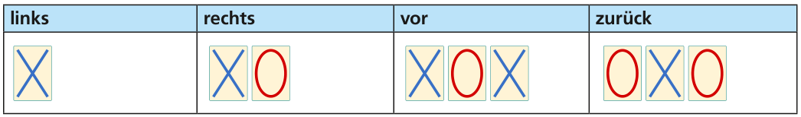
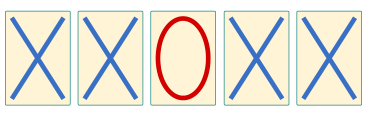

Jana und Robin spielen mit ihrem Modellflugzeug. Sie lassen es von einem Hügel aus starten und weit weg im Gras landen. Dann geht Robin das Flugzeug holen. Aber das Gras ist hoch, und nur vom Hügel aus kann man das Flugzeug sehen.

Jana zeigt vom Hügel aus, wohin Robin laufen muss, um das Flugzeug zu finden. Dazu haben sie zwei Schilder mitgebracht (ein Schild mit blauem X und eines mit rotem O) und diesen Code vereinbart:

Leider gibt es ein Problem mit diesem Code. Ein Beispiel:

Diese Schilderfolge kann bedeuten: links, vor, links. Sie kann aber auch bedeuten: links, rechts, links, links.

Jana und Robin überlegen sich deshalb einen neuen Code. Damit kann es keine Schilderfolge geben, die mehrere Bedeutungen hat.

**Welcher ist der neue Code?**
