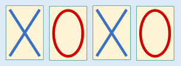
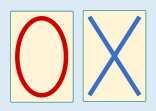
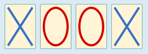
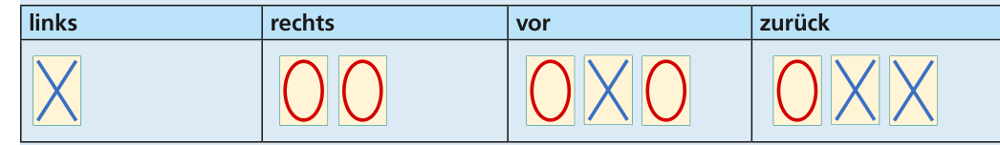

Die richtige Antwort ist C. Die Antworten A, B und D sind falsch. Für diese Codes kann man Schilderfolgen angeben, die mehrere Bedeutungen haben:

Antwort A: Diese Schilderfolge kann „rechts, rechts“, aber auch „links, zurück“ bedeuten.

Antwort B: Diese Schilderfolge kann „vor“, aber auch „links, rechts“ bedeuten.

Antwort D: Diese Schilderfolge kann „vor“, aber auch „links, zurück“ bedeuten.

Der Code von Antwort C hat eine besondere Eigenschaft: Jedes Codewort, also jede Schilderfolge, die eine der vier Richtungen bedeutet, beginnt mit einem einzigen Schild X, auf das 0, 1, 2 oder 3 Schilder mit einem O folgen. Allein die Anzahl der Schilder mit O bestimmt, um welches Codewort es sich handelt. Deshalb kann jedes Codewort eindeutig durch eine der Ziffern 0, 1, 2 oder 3 ersetzt werden. Jede Schilderfolge entspricht also einer Folge dieser Ziffern. Jede Ziffer bedeutet genau eine Richtung; mehrere Bedeutungen kann eine solche Ziffernfolge – und damit die entsprechende Schilderfolge – nicht haben.

## Das ist Informatik!

Wenn Computer sich gegenseitig Nachrichten senden, dann werden diese in eine Folge von Signalen oder Zeichen übersetzt. Die spezielle Art und Weise, wie diese Übersetzung erfolgt, wird als Code bezeichnet. Von Binär-Code spricht man, wenn nur zwei verschiedene Zeichen vorkommen können. Die einzelnen übersetzten Nachrichten bezeichnet man als Codewörter.

Vom Empfänger müssen diese Codewörter wieder richtig decodiert werden. Dabei ergibt sich das Problem, zwei aufeinanderfolgende Codewörter voneinander zu trennen. Eine Möglichkeit wäre, einen Blockcode zu verwenden, dessen Wörter alle gleich lang sind. Dann ergeben sich die Grenzen zwischen Codewörtern automatisch. Blockcodes führen allerdings zu im Schnitt unnötig langen Nachrichten. In dieser Biberaufgabe kommt ein Code mit Wörtern unterschiedlicher Länge zum Einsatz.

Im Lösungscode oben wurde der einfache Trick angewendet, dass jedes Codewort mit einem X beginnt und dann nur noch aus weiteren O besteht. Damit wirkt das X wie ein Trennzeichen zwischen den Codewörtern. Das ist eine gute Idee für Codes mit wenigen Codewörtern, hat aber den Nachteil, dass bei dieser Lösung die Länge der Codewörter mit jedem weiteren benötigten Codewort wächst. Eine elegantere Lösung ist ein sogenannter Präfixcode oder präfixfreier Code. In einem Präfixcode beginnt kein Codewort mit der vollständigen Folge von Zeichen eines anderen Codewortes. Deshalb kann man auch ohne Trennzeichen unterschiedlich lange Codewörter erkennen und dekodieren. Und als Codes mit variabler Wortlänge eignen sich Präfixcodes gut zur Verdichtung (Komprimierung) von Information.

Dies ist ein Präfixcode für Jana und Robin:

