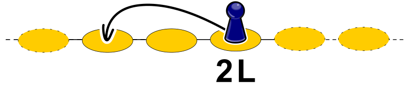
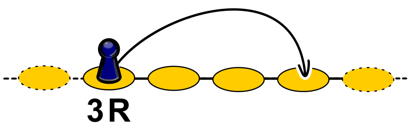
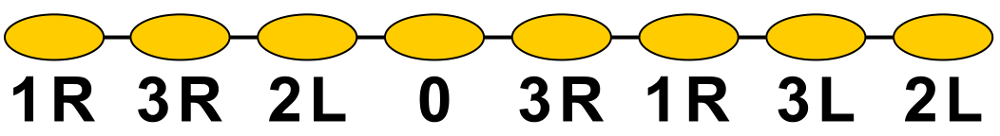

In einem Spiel zieht die Spielfigur über eine Reihe von Feldern. Bei jedem Feld steht eine Anweisung. Sie sagt, wohin die Figur von dem Feld aus ziehen soll.

Es gibt drei Arten von Anweisungen:

- *n* L bedeutet: Ziehe *n* Felder nach links. Ein Beispiel:

- *n* R bedeutet: Ziehe *n* Felder nach rechts. Ein Beispiel:

- 0 bedeutet: Bleib stehen.

Unten siehst du das gesamte Spiel mit allen Anweisungen. Die Spielfigur soll so ziehen, dass sie am Ende auf jedem Feld genau einmal gewesen ist.

**Auf welchem Feld muss die Spielfigur starten?**

Klicke auf ein Feld, um es als Startfeld auszuwählen.

