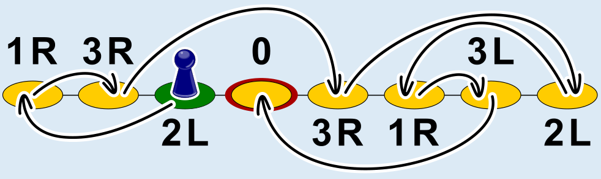

Die Spielfigur muss auf dem dritten Feld von links („2L“) starten. Von dort aus zieht sie über alle Felder bis zum Feld mit der Anweisung „0“ und bleibt stehen.

Um das richtige Startfeld zu bestimmen, kann man beim letzten Feld „0“ beginnen und von dort aus rückwärts den Weg über die Felder suchen. Ausgehend vom Feld „0“ wird für jedes Feld dessen „Herkunftsfeld“ bestimmt, von dem aus die Spielfigur auf das Feld zieht, und dann wird von diesem Herkunftsfeld aus weiter gesucht. Das Herkunftsfeld von Feld „0“ ist das zweite Feld von rechts („3L“). Dessen Herkunftsfeld wiederum ist das dritte Feld von rechts („1R“); von dort aus geht es weiter zum Feld ganz rechts („2L“) usw. bis zum dritten Feld von links („2L“). Dieses Feld hat kein Herkunftsfeld, und glücklicherweise hat die Rückwärtssuche damit auch alle Felder erreicht.

Dass ein Weg über alle Felder möglich ist, liegt an den passend gewählten Anweisungen des Spiels. Stünde z. B. auf dem zweiten Feld von links die Anweisung „1L“ statt „3R“, würde die Spielfigur endlos zwischen den beiden linken Feldern hin und her springen und weder stehen bleiben noch auf ihrem Weg über alle Felder ziehen können.

## Das ist Informatik!

In der Biberaufgabe „Licht an!“ geht es um das Problem, einen Weg von einem Startzustand zu einem bestimmten Zielzustand zu suchen. Auch bei anderen Problemen wird gesucht, etwa wenn sozusagen aus dem Nichts die (beste) Lösung eines Problems konstruiert werden muss – wie der Arbeitsplan in der Biberaufgabe „Biber-Arbeit“. Der leere Arbeitsplan ist dann der Startzustand der Suche, und Zielzustand ist jeder Arbeitsplan, bei dem alle Aufgaben verteilt wurden.

Suchen spielt eine große Rolle in der Informatik. Auch in dieser Biberaufgabe sucht die Spielfigur einen Weg vom Start zum Ziel. Allerdings ist nur das Ziel bekannt. Zum Glück kann jeder Schritt von einem Zustand zum nächsten umgedreht werden: wir können für jedes Feld das Herkunftsfeld bestimmen, wie oben beschrieben. Deshalb kann man die Suche umdrehen und vom Ziel aus den Start suchen. In dieser Biberaufgabe kann von jedem Zustand aus nur ein anderer Zustand erreicht werden. Deshalb ist die Suche über die acht Felder schon nach sieben Schritten zu Ende.

Bei den meisten Problemen, die in der Informatik mit Suchmethoden angegangen werden, gibt es von jedem Zustand aus mehrere Möglichkeiten, einen anderen Zustand zu erreichen oder zu konstruieren. Dann ist der „Suchraum“ keine Linie wie in dieser Aufgabe, sondern ein stark verzweigter Baum mit möglicherweise sehr vielen Zuständen. Um auch große Suchräume einigermaßen schnell durchsuchen zu können, werden gute algorithmische Ideen benötigt.
