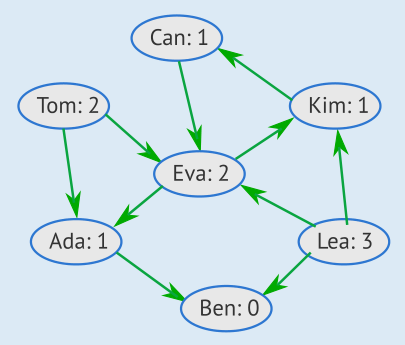
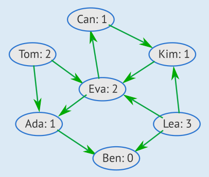

Es gibt zwei Möglichkeiten, wie man für alle Freundespaare die „Schenkrichtung“ angeben kann, ohne dass ein Kind mehr Geschenke besorgen muss, als es besorgen kann.

Wir beginnen mit Ben: Er kann kein Geschenk besorgen und erhält deshalb je ein Geschenk von seinen Freundinnen Ada und Lea. Damit hat Ada ihr Geschenk vergeben und erhält selbst je ein Geschenk von Eva und Tom. Für die Freundespaare Ben&Ada, Ben&Lea, Ada&Eva und Tom&Eva sind die Schenkrichtungen also klar.

Auf den ersten Blick scheint es nun viele weitere Möglichkeiten zu geben. Wer genau hinsieht, erkennt aber, dass die Freunde Can und Kim jeder nur ein Geschenk besorgen können. Deshalb gibt es bei diesem Freundespaar nur zwei Möglichkeiten:

1. Kim besorgt ein Geschenk für Can: Dann hat Kim sein Geschenk vergeben und erhält ein Geschenk von seiner Freundin Eva. Damit hat auch Eva ihre Geschenke vergeben und erhält Geschenke von ihren Freunden Can (der ja sein Geschenk noch frei hat), Tom und Lea. Lea, die auch schon für Ben ein Geschenk besorgen muss, hat aber immer noch ein Geschenk frei und besorgt es für Kim. Damit sind die Schenkrichtungen für alle Freundespaare festgelegt, und zwar so wie im Bild links.
2. Can besorgt ein Geschenk für Kim: Dann hat Can sein Geschenk vergeben und erhält ein Geschenk von seiner Freundin Eva. In diesem Fall erhält Eva Geschenke von Kim, Tom und Lea; Lea besorgt auch hier ihr letztes Geschenk für Kim. Damit sind die Schenkrichtungen so festgelegt wie im Bild rechts.

Egal welche der beiden möglichen Schenkrichtungen für das Freundespaar Can&Kim gewählt wird, ergeben sich alle weiteren Schenkrichtungen daraus eindeutig. Es gibt also insgesamt nur zwei verschiedene Möglichkeiten, alle Schenkrichtungen festzulegen.

## Das ist Informatik!

Die Freundschaften zwischen den Kindern bilden ein Netzwerk aus Knoten (die Kinder) und Verbindungen (die Freundschaftsbeziehungen selbst). Das erinnert an die so genannten „sozialen Netzwerke“ mit ihren Millionen von Benutzern. Es gibt aber einen wichtigen Punkt, in dem sich diese Systeme unterscheiden können: In manchen gibt es wechselseitige „Freundschaften“, in denen die Verbindungen keine Richtung haben, so wie in dieser Biberaufgabe. In anderen gibt es „Anhänger“ (Englisch: „follower“), und dann haben die Verbindungen eine Richtung: Wenn du einer berühmten anderen Nutzerin „folgst“, muss sie nicht auch dir folgen.

In dieser Biberaufgabe sollen aus allen Freundschafts-Verbindungen (ohne Richtung) nun „Schenk-Verbindungen“ (mit Richtung) werden. Entlang dieser Richtung soll über jede Verbindung dann ein Geschenk „fließen“. Aber die „Schenk-Kapazitäten“ der Kinder setzen der Wahl der Richtungen Grenzen. Das ähnelt einem in der Informatik bekannten Problem: In einem Netzwerk (etwa aus Wasserkanälen oder Kommunikationsverbindungen) soll so viel (Wasser oder Daten) über die Verbindungen fließen wie möglich, aber die Kapazitäten der Verbindungen sind begrenzt. Nur sind bei einem solchen „Netzwerk-Fluss“ Grenzen für die Verbindungen angegeben, bei dieser Biberaufgabe hingegen für die Knoten. Es ist aber leicht möglich, das Problem der Schenkrichtungen in ein „Fluss-Problem“ umzuwandeln. Und dann lässt sich das „Schenkrichtungs-Problem“ mit den effizienten Algorithmen lösen, welche die Informatik für Fluss-Probleme kennt. Dieser Trick ist übrigens in der Informatik sehr beliebt: Ein Problem wird in ein anderes Problem umgewandelt (die Informatik sagt auch: reduziert), für das Lösungen gut bekannt sind.
