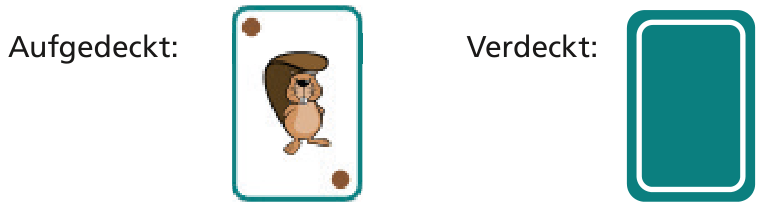
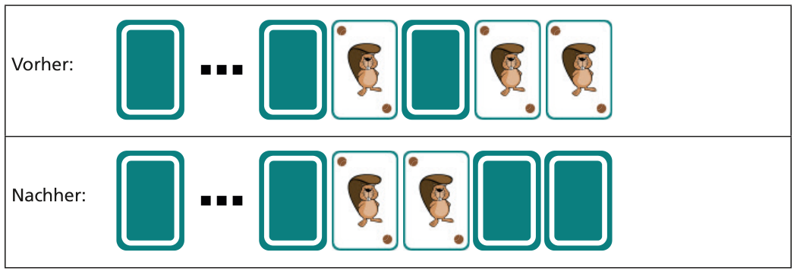
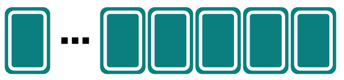

Jemand schenkt dir einen Satz gleicher Karten. Die Karten sehen so aus:

Mit diesen Karten kannst du „Drehen“ spielen. Eine Reihe von Karten liegt vor dir. In einem Spielzug gehst du diese Karten von rechts nach links so durch:

- Ist die aktuelle Karte verdeckt, decke sie auf. Damit ist der Spielzug beendet, die übrigen Karten bleiben unverändert.
- Ist die aktuelle Karte aufgedeckt, drehe sie um.

Das Bild zeigt, wie sich die Karten in einem Spielzug verändern können.

Diesmal beginnt das Spiel mit 16 verdeckten Karten.

**Wie viele Karten sind nach 16 Spielzügen aufgedeckt?**
