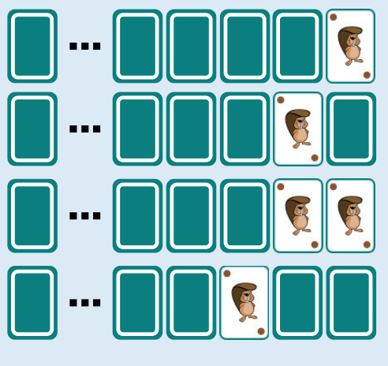

1 ist die richtige Antwort. Woran erinnern uns die Karten? Eine Reihe von gleichen Karten, die entweder verdeckt oder aufgedeckt sein können, stellt eine Binärzahl dar. Binärzahlen bestehen nur aus den Ziffern 0 und 1. Eine verdeckte Karte stellt die Ziffer 0 dar und eine aufgedeckte Karte die Ziffer 1.

Analog zum üblichen Zehnersystem gibt jede Stelle einer Binärzahl an, ob die passende Zweierpotenz in den Wert der Zahl einzurechnen ist oder nicht. Ist z. B. die dritte Stelle (von rechts) einer Binärzahl mit einer 1 besetzt, ist die dritte Zweierpotenz zum Wert der Zahl zu addieren – also 22, denn wir fangen bei 20 an.

Binärzahlen werden auf diese Weise um 1 hochgezählt. Man beginnt mit der Ziffer ganz rechts: Ist die aktuelle Ziffer eine 0, mache daraus eine 1. Damit ist die gesamte Zahl um 1 hochgezählt. Ist die aktuelle Ziffer eine 1, mache daraus eine 0 und gehe zur nächsten Ziffer nach links (Übertrag). Das entspricht genau einem Spielzug im Spiel „Drehen“. Ein Spielzug erhöht also den Wert der Binärzahl, die durch die Kartenreihe dargestellt wird, um 1. Die verdeckten Karten zu Beginn stellen die Binärzahl dar, die nur aus 0en besteht, also den Wert 0 hat.

Das Bild zeigt die ersten vier Spielzüge, die also von 1 bis 4 zählen. Man kann sehen, dass bei den Zahlen 1, 2 und 4 (also den Zweierpotenzen 20, 21 und 22) genau eine Karte aufgedeckt ist: Bei einer Binärzahl, die eine Zweierpotenz als Wert hat, ist nur an der Stelle, die dieser Zweierpotenz entspricht, eine 1.

Nach 16 Spielzügen erhalten wir also die Darstellung einer Binärzahl mit Wert 16. Da 16 = 24, hat diese Binärzahl genau an der fünften Stelle von rechts eine 1 und sonst nur 0en: 0…010000. In der Darstellung mit den Karten ist also genau eine Karte aufgedeckt.

## Das ist Informatik!

Die kleinste Speichereinheit eines Computers kann nur zwei Werte unterscheiden: AN und AUS, WAHR oder FALSCH, 0 oder 1. Alle Daten, die in einem Computer gespeichert und verarbeitet werden, können wir also als Reihen binärer Ziffern, letztlich also als Binärzahlen sehen. Deshalb haben Operationen auf Binärzahlen für die Informatik eine große Bedeutung.

Seitdem es Computer gibt, werden darin solche Operationen möglichst effizient realisiert. Es gibt Operationen, die zwei Binärzahlen miteinander verknüpfen, wie etwa die Rechenoperationen Addition oder Multiplikation. Es gibt aber auch Operationen, die eine einzelne Binärzahl verändern, etwa das Verschieben aller Ziffern um eine Position nach links (was einer Multiplikation mit 2 entspricht) – oder eben das Hochzählen, also die Addition um 1, die in dieser Biberaufgabe die zentrale Rolle gespielt hat.
