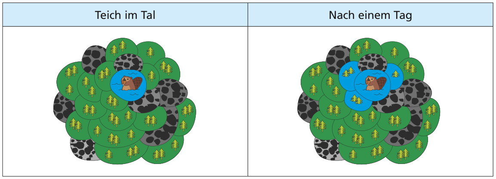

In einem Tal liegt ein kleiner Teich. Er ist umgeben von Landstücken mit Wald oder mit Felsen. Im Teich leben einige Biber. Eines Tages wird den Bibern der Teich zu klein, und nun fluten sie den Wald. An jedem Tag fluten sie alle Waldstücke, die an bereits geflutete Waldstücke angrenzen. Nach einem Tag sind drei Waldstücke geflutet.

**Nach wie vielen Tagen sind alle Waldstücke geflutet?**
