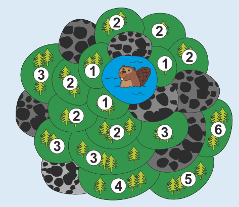

6 ist die richtige Antwort. Das Bild zeigt für jedes Waldstück, nach wie vielen Tagen es geflutet ist: Die Waldstücke, die an den See angrenzen, sind nach einem Tag geflutet und deshalb mit der Zahl 1 markiert. Die Waldstücke, die an diese Felder angrenzen, sind mit der Zahl 2 markiert; sie sind nach zwei Tagen geflutet. Und so weiter. 6 ist die größte Zahl, mit der ein Waldstück auf diese Weise markiert wird. Nach sechs Tagen ist also dieses Waldstück geflutet – und damit alle Waldstücke im Tal.

## Das ist Informatik!

In dieser Biberaufgabe fluten die Biber ein zusammenhängendes Waldgebiet, das aus einzelnen, benachbarten Waldstücken besteht – und dem ursprünglichen Teich. Das Gebiet ist zusammenhängend, weil jedes Waldstück in diesem Gebiet zu mindestens einem anderen Waldstück benachbart ist. So kann man von jedem Stück des Gebietes jedes andere Stück über einen Weg durch das Gebiet selbst erreichen.

Gibt es zusammenhängende Gebiete auch außerhalb des Biber-Teich-Tals? Aber natürlich! Ein einfarbiger Bereich in einem (Computer-)Bild ist ein zusammenhängendes Gebiet gleichfarbiger Pixel. Eine Gruppe von Jugendlichen, in denen jeder mindestens mit einem anderen Jugendlichen der Gruppe befreundet ist, ist auch ein zusammenhängendes Gebiet, wenn man die Freundschaftsbeziehung als Nachbarschaft betrachtet.

Die Informatik kennt Methoden, zusammenhängende Gebiete zu ermitteln, etwa die Breitensuche oder die Tiefensuche. Mit Hilfe dieser Methoden können z. B. Bereiche in Bildern umgefärbt oder Gruppierungen in sozialen Netzwerken ermittelt werden.
