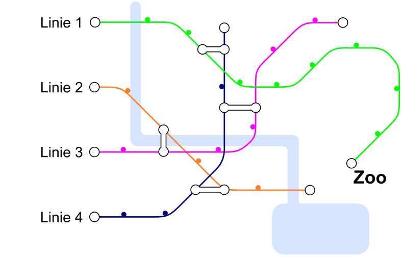

In Biberstadt gibt es vier Bahnlinien. Eine Linie fährt zum Zoo. An den Stationen, an denen zwei Kreise durch eine Linie verbunden sind, kann man von einer Linie zu einer anderen wechseln. Johannes fährt zum Zoo. Er muss nur einmal die Linie wechseln.

**Mit welcher Linie fährt er los?** Klicke links die richtige Linie an.
