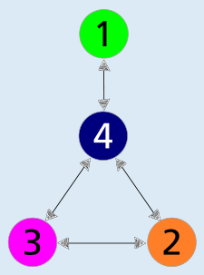

Johannes fährt mit Linie 4 los. Nur Linie 4 hat eine Station, an der man direkt zu Linie 1 wechseln kann. An dieser Station wechselt Johannes zu Linie 1 und fährt damit weiter zum Zoo.

Das Bild stellt übersichtlich dar, von welcher Linie aus man zu welcher anderen Linie wechseln kann. Die Kreise enthalten die Liniennummern. Ein Doppelpfeil zwischen zwei „Linien-Kreisen“ bedeutet, dass man zwischen diesen Linien wechseln kann. So ist sofort sichtbar, dass Johannes nur von Linie 4 aus direkt zu Linie 1 wechseln kann.

## Das ist Informatik!

Während man beim Bahnliniennetz von Biberstadt noch recht genau hinschauen muss, kann man die Antwort auf die Frage dieser Biberaufgabe aus dem obigen Bild unmittelbar ablesen. Aber warum geht es damit so viel einfacher? Weil beim Erstellen der „einfachen“ Abbildung gleich zwei wichtige Methoden der Informatik angewandt wurden. Zum einen die *Abstraktion*: Das neue Bild enthält nur noch die für die Beantwortung der Frage wichtige Information, von welcher Linie man zu welcher anderen wechseln kann. Zum anderen die *Reduktion*, also die Umwandlung eines Problems in ein anderes, vielleicht einfacheres Problem: Die Frage nach dem einmaligen Umstieg in die Linie zum Zoo wird zur Frage, welcher Kreis im Bild mit dem Kreis 1 direkt per Doppelpfeil verbunden ist. Wenn ein neues Problem in ein bekanntes Problem umgewandelt, also reduziert werden kann, lässt sich die Schwierigkeit des neuen Problems mit der des bekannten Problems vergleichen. Zum Beispiel ist das Problem, eine Zahl auf Teilbarkeit durch 5 zu prüfen, recht leicht zu lösen. Es lässt sich nämlich auf die Frage reduzieren, ob die letzte Ziffer der Zahl eine 0 oder eine 5 ist.
