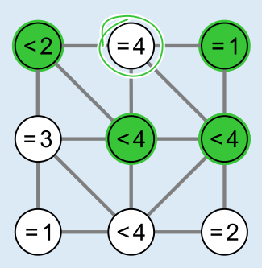
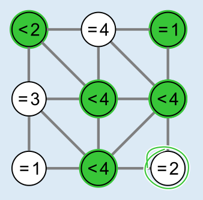

Um die richtigen Kreise auszuwählen, kann man mit den Bedingungen anfangen, die keine Wahl zulassen. Die Bedingung im Kreis oben Mitte lautet „= 4“. Sie legt zwingend fest, dass alle vier Nachbarn ausgewählt werden müssen; siehe Bild links. In gleicher Weise legt die Bedingung „= 2“ im Kreis rechts unten fest, dass alle zwei Nachbarn ausgewählt werden müssen; siehe Bild rechts.

Damit sind bereits die Bedingungen in allen neun Kreisen erfüllt. Und es ist nicht möglich, einen weiteren Kreis auszuwählen, ohne eine Bedingung zu verletzen.

## Das ist Informatik!

Damit Computer tun, was Menschen wollen, müssen sie mit klaren Anweisungen versorgt werden. Deshalb ist in der Informatik Klarheit schon beim Nachdenken über diese Anweisungen erforderlich. Auch in dieser Biberaufgabe müssen einige Begriffe klar unterschieden werden: Eine Lösung der Aufgabe ist eine Auswahl der Kreise, die alle Bedingungen erfüllt. Nicht jede mögliche Auswahl ist auch eine Lösung, kann aber als Kandidat für eine Lösung bezeichnet werden.

Bei den meisten Problemen gibt es viele Wege, Lösungen zu finden. Fast immer ist es möglich, alle Kandidaten aufzuzählen und zu prüfen, ob sie eine Lösung darstellen. Diese Vorgehensweise wird in der Informatik als „brute force“ bezeichnet, was so viel heißt wie „rohe Kraft“. In dieser Biberaufgabe gibt es 29 = 512 Kandidaten, denn bei der Auswahl von Kreisen gibt es für jeden der neun Kreise zwei Möglichkeiten: auswählen oder nicht auswählen. Für die Prüfung von 512 Kandidaten reicht die Zeit beim Informatik-Biber aber nicht; rohe Kräfte walten eben häufig sinnlos, wie schon Friedrich Schiller wusste. Ein systematisches Vorgehen, das die angegebenen Bedingungen (engl. auch „constraints“) ausnutzt, um den Kandidatenkreis möglichst schnell zu verringern, ist viel effizienter.
