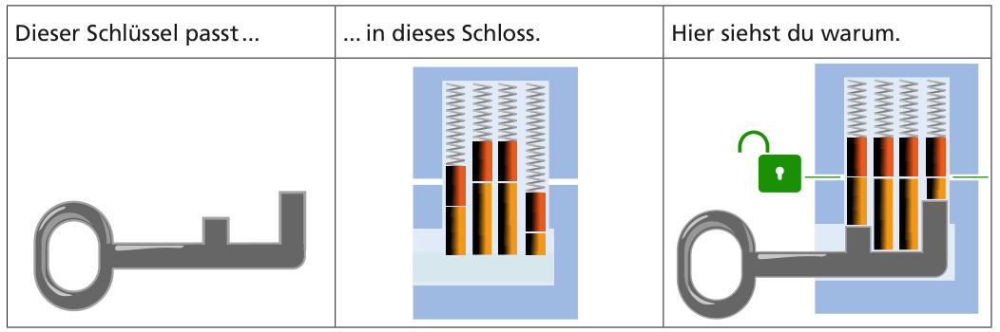
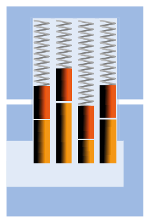
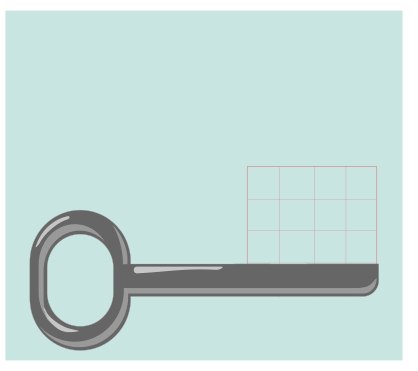

Dieser Schlüssel passt in dieses Schloss. Hier siehst du, warum:

Hier ist ein anderes Schloss:

Unten siehst du einen Schlüssel. Über seinem Bart gibt es vier Spalten mit je drei Kästchen.

**Klicke auf die Kästchen, bis der Schlüssel passt.**

Fülle dazu in jeder Spalte die Kästchen von unten nach oben so weit, wie der Bart dort reichen muss.
