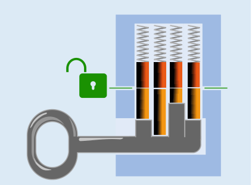

Die Bartteile des Schlüssels müssen das Gegenstück zu den Stiften des Schlosses bilden. Ein Bartteil muss also umso länger sein, je kürzer der zugehörige Schlüsselstift ist. Für dieses Schloss gilt von links nach rechts: ein Kästchen, kein Kästchen, zwei Kästchen, ein Kästchen.

## Das ist Informatik!

Der Schlüssel passt, wenn jedes Teil seines Barts zum zugehörigen Teil im Schloss passt. Das durch die Bartteile gebildete Muster muss also zum Muster der Schlossteile passen.

Mustervergleich, auf Englisch „pattern matching“, ist ein wichtiger Bestandteil vieler Systeme und Methoden der Informatik. Jede Suchfunktion muss in der Lage sein, in Texten, Webseiten oder anderen Datenmengen die Stellen zu finden, die zum Suchmuster passen. Besonders nützlich und interessant sind Methoden zum Mustervergleich, bei denen das Muster nicht genau, sondern nur ungefähr passen muss. Dabei werden zwei Ansätze unterschieden: Entweder gibt der Benutzer direkt an (z. B. mit Hilfe so genannter regulärer Ausdrücke), welcher Spielraum beim Mustervergleich zugelassen ist. Das ist wie bei einem Generalschlüssel, der zu allen Schlössern eines Hauses, aber nicht zu Schlössern anderer Häuser passt. Oder der Mustervergleich ist grundsätzlich „unscharf“ und erklärt auch solche Muster als passend, die sich nur leicht voneinander unterscheiden. So können z. B. Internet-Suchmaschinen auch bei falsch geschriebenen Suchwörtern noch passende Webseiten finden. Auch eine am Klang von Wörtern orientierte phonetische Suche (siehe auch die Biberaufgabe „Klang-Code“) ist unscharf.
