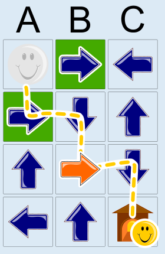

Der Weg des Smiley nach Hause ist zu erkennen: A1 – A2 – B2 – B3 – C3 – C4. Der Pfeil, dessen Richtung geändert wurde, um diesen Weg zu ermöglichen, ist orange dargestellt (B3).

Man kann sogar beweisen, dass dies die einzig mögliche Lösung ist. Die Idee: Du beginnst am Ziel C4 und gehst rückwärts. Man könnte von zwei Feldern aus zum Ziel C4 gelangen: von B4 und von C3. Der Pfeil in B4 zeigt aber in die falsche Richtung und müsste geändert werden. Weil aber kein Pfeil zu B4 zeigt, müsste ein zweiter Pfeil geändert werden. Das ist aber nicht erlaubt. Folglich ist das Ziel nur über C3 erreichbar. Der Pfeil in diesem Feld zeigt bereits auf das Ziel.

Wie aber ist C3 zu erreichen? Wir gehen weiter rückwärts: C3 wäre von B3 oder C2 aus zu erreichen. Weil aber kein Pfeil zu C2 zeigt, müsste ein zweiter Pfeil geändert werden. Das ist aber nicht erlaubt. Folglich ist das Ziel nur über B3 erreichbar. Dazu ändern wir die Pfeilrichtung in B3 so, dass sie auf C3 zeigt.

Wie ist nun B3 zu erreichen? Von B3 aus können wir weiter rückwärts gehen, ohne Pfeile zu verändern, nämlich über B2 zum Eingang A2 zum Startfeld A1. Damit haben wir einen Weg für den Smiley gefunden. Für diesen Weg muss nur die Pfeilrichtung in B3 geändert werden.

## Das ist Informatik!

Das Pfeil-Labyrinth in dieser Biberaufgabe ist so klein und übersichtlich, dass man die richtige Antwort mit ein wenig Überlegung und Ausprobieren finden kann. Wenn das Labyrinth aber sehr groß wäre, würden Menschen die Übersicht schnell verlieren. Da könnte ein Computer helfen, doch dem müsste ein systematisches Vorgehen einprogrammiert werden. Wie könnte das aussehen?

Nun, zum Beispiel genau so, wie beim obigen Beweis vorgegangen wurde: Vom Ziel aus schrittweise einen Weg zusammenstellen; bei jedem Schritt die Möglichkeiten merken, die zunächst nicht verfolgt werden; wenn es bei einer Möglichkeit nicht mehr weitergeht, dann zurücksetzen und die nächste verfolgen. Diese Art von Lösungssuche ist in der Informatik als „Backtracking“ bekannt (engl.: back = zurück; track = Spur): Wie im Märchen von Hänsel und Gretel wird bei der Suche eine Spur gelegt, entlang derer man zurückgehen kann.
