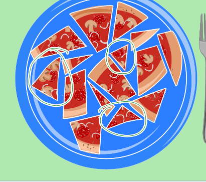

Im Bild sind die Pizza-Stücke ohne Kruste eingekringelt (das Stück ganz links, das kleine spitze Stück in der oberen Mitte und das Dreieck unten in der Mitte). Diese Stücke muss Lucy mit der Gabel essen.

## Das ist Informatik!

Bei jedem Pizza-Stück muss Lucy fragen: Hat es eine Kruste oder nicht? Abhängig davon, wie die Antwort auf die Frage ausfällt, verhält Lucy sich unterschiedlich: Bei „ja“ isst sie das Stück so, wie sie Lust hat (also im Zweifel mit der Hand), bei „nein“ isst sie es mit der Gabel. Lucys Verhalten „verzweigt“ also abhängig davon, ob die Krusten-Bedingung für ein Pizza-Stück wahr ist oder nicht.

Solche bedingten Verzweigungen gehören zu den Grundbausteinen für Computerprogramme. Entscheidend ist, dass es für die zu prüfenden Bedingungen nur zwei Möglichkeiten gibt: Sie sind erfüllt bzw. wahr, oder sie sind nicht erfüllt bzw. falsch. Dann wird im Programm für eine oder für beide Möglichkeiten angegeben, wie sich der Computer zu verhalten hat. Ein „Programm“ für Lucys Pizza-Essen würde in einer Programmiersprache in etwa so beschrieben:

*WENN das Stück eine Kruste hat*  
*DANN iss es so, wie du magst*  
*SONST iss es mit der Gabel*
