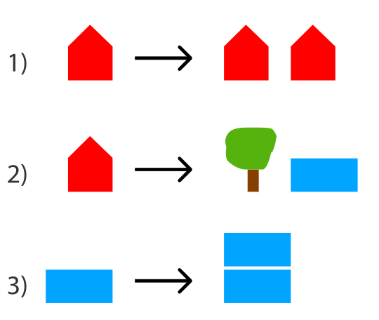
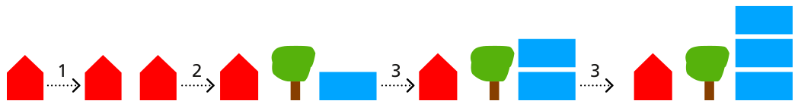

Die Leute auf Planet Z bauen ihre Städte immer auf die gleiche Weise. Sie beginnen mit einem Haus (ein rotes Haus). Dann ersetzen sie einzelne Objekte nach diesen drei Regeln:

Ein Beispiel: Wenn man zuerst Regel 1, dann Regel 2 und dann zwei Mal Regel 3 anwendet, baut man eine Stadt wie ganz rechts im Bild:

Beachte, dass die Reihenfolge der Objekte nicht verändert wird.

**Welche Stadt steht NICHT auf Planet Z?**
