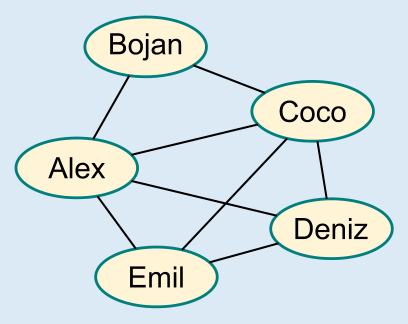

B ist die richtige Antwort. Im Bild ist für jeden Tänzer ein Oval mit seinem Namen zu sehen. Außerdem sind zwei Ovale mit einer Linie verbunden, wenn die beiden Tänzer ein Paar bilden.

Ein Probenplan, für den die Ansage der Trainerin gilt, ist dann ein „Weg“ durch das Bild: Dieser beginnt bei einem Oval und geht genau einmal an jeder Paar-Linie entlang. Dabei muss der Weg jedes Oval, zu dem er zwischendurch kommt, auch wieder verlassen. Von diesen Ovalen muss also eine gerade Anzahl an Linien ausgehen. Ausnahmen sind die Ovale, an denen der Weg beginnt bzw. endet; von diesen Ovalen geht eine ungerade Anzahl Linien aus.

Allein von den Ovalen von Deniz und Emil geht eine ungerade Anzahl Linien aus (nämlich jeweils drei Linien). Nur diese beiden können also zum ersten (oder zum letzten) Paar gehören. Bojan ist der einzige Tänzer, der weder mit Deniz noch mit Emil ein Paar bildet. Nur er kann auf keinen Fall zum ersten Paar des Probenplans gehören.

## Das ist Informatik!

Das Bild oben zeigt, wie die Tanzpaare als *Graph* dargestellt werden. Ein Graph besteht aus Knoten (hier: die Tänzer) und Kanten (hier: die Paar-Bildungen der Tänzer). Das ist eine sehr vielseitige Struktur, die bei vielen Informatik-Aufgabenstellungen zur Modellierung insbesondere von Netzwerken verwendet wird, z. B. bei Verkehrs- oder Kommunikationsnetzen. In dieser Biberaufgabe bilden die Tänzer ein Paar-Netzwerk. In vielen Netzwerken kann es nötig sein, auf einem Weg von einem Start- zu einem (unterschiedlichen) Zielknoten alle Verbindungen abzugehen. Dabei stellt sich die Frage (z. B. aus Gründen der Effizienz), ob es möglich ist, auf einem solchen Weg jede Verbindung nur einmal zu begehen. Falls das möglich ist, wird ein entsprechender Weg auch als Eulerweg bezeichnet. Denn schon der Erfinder der Graphentheorie, Leonhard Euler, hat bewiesen, dass das genau dann möglich ist, wenn exakt zwei Knoten eine ungerade Anzahl Verbindungen mit anderen Knoten haben (und alle anderen Knoten folglich eine gerade Anzahl von Verbindungen haben). Nur diese beiden Knoten können Anfangs- oder Endpunkt des Eulerweges sein.

Vielleicht hast du das Paar-Netzwerk dieser Biberaufgabe schon einmal gesehen. Wenn man es ein wenig dreht und die Knoten verkleinert, erkennt man die Ähnlichkeit besser: Das ist das Haus vom Nikolaus! Wer das Haus vom Nikolaus in einem Zug zeichnet, geht also einen Eulerweg entlang der Linien des Hauses.
