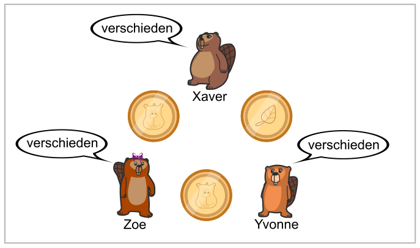
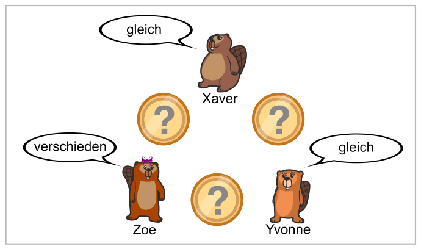

Die drei Freunde Xaver, Yvonne und Zoe besuchen die berühmte Eisdiele „Al Goritmo“. Als sie fertig sind, sagt der Kellner: „Die Rechnung ist schon bezahlt.“ Wer hat das Eis bezahlt: Einer von ihnen, oder jemand anderes? Das wollen sie herausfinden, ohne sich direkt zu fragen – und zwar so:

Zuerst werfen sie paarweise je die gleiche Münze: Xaver und Yvonne, Xaver und Zoe sowie Yvonne und Zoe. Anschließend kennt jeder zwei Münzwurf-Ergebnisse und sagt den anderen, ob diese gleich oder verschieden ausgefallen sind. Aber Achtung:

- Wenn jemand von ihnen das Eis bezahlt hat, sagt sie oder er die Unwahrheit.
- Wer nicht bezahlt hat, sagt die Wahrheit.

Ein Beispiel: Wir nehmen an, Zoe habe das Eis bezahlt – streng geheim. Die Biber werfen Münzen, das Bild zeigt die Ergebnisse. Alle sagen „verschieden“.

In der Eisdiele wird nun die Münze geworfen. Biber Nosy am Nachbartisch hört nur, was die Freunde nach den Münzwürfen sagen: Xaver sagt „gleich“, Yvonne sagt „gleich“ und Zoe sagt „verschieden“.

**Was weiß der schlaue Nosy jetzt?**
