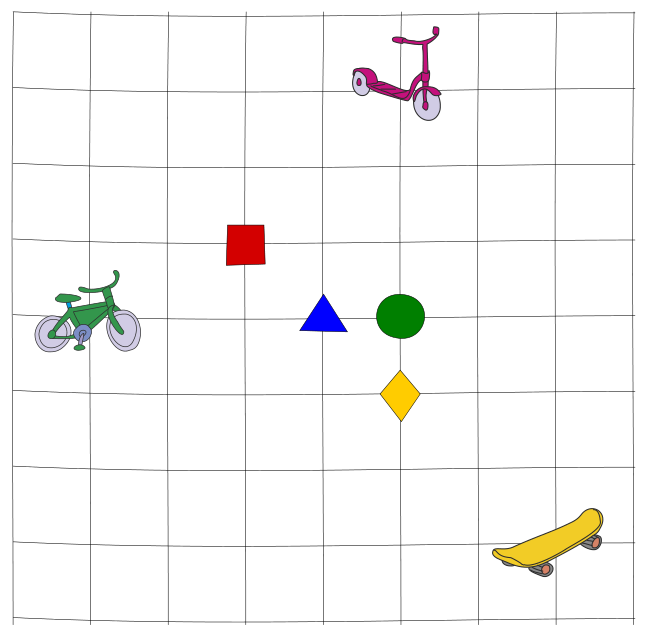

Drei Freunde wollen sich treffen. Sie starten mit ihren Fahrzeugen (Roller, Fahrrad und Skateboard) an verschiedenen Kreuzungen. Zwischen zwei Kreuzungen fahren sie immer den kürzesten Weg, über die Straßen zwischen den Kreuzungen.

Ein Beispiel: Zur Kreuzung mit dem blauen Dreieck muss der Roller 4 Straßen fahren.

Die Freunde können sich an den Kreuzungen mit dem roten Quadrat, dem blauen Dreieck, dem grünen Kreis oder der gelben Raute treffen. Der beste Treffpunkt ist der, zu dem sie insgesamt möglichst wenig Straßen fahren müssen.

**Was ist der beste Treffpunkt?**

Klicke auf die richtige Kreuzung.
