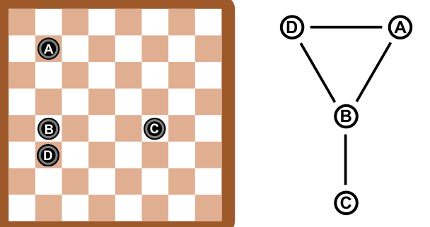
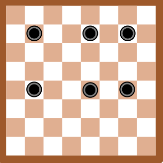

Auf einem Spielbrett liegen vier Spielsteine. Zwei Spielsteine, die auf der selben Zeile oder auf der selben Spalte des Spielbretts liegen, gelten als *verbunden*. Das Bild neben dem Spielbrett beschreibt die Spielsituation. Die Linien zeigen, wie die Steine verbunden sind.

Jetzt liegen sechs Spielsteine auf dem Spielbrett.

**Welches Bild beschreibt die neue Spielsituation?**
