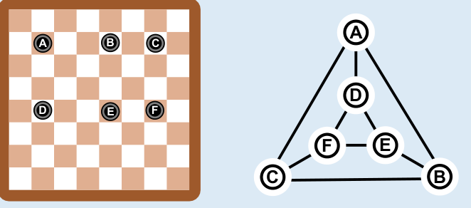

Antwort A ist richtig: Das ist leichter zu erkennen, wenn die Spielsteine und die Kreise in Antwort A beschriftet sind.

Aber die richtige Antwort kann auch ohne passende Beschriftung gefunden werden. Es genügt, allein die Eigenschaften der in den Antworten dargestellten Strukturen zu betrachten. Auf dem Spielbrett befinden sich 6 Steine; also kann nur ein Bild mit sechs Kreisen die Spielsituation beschreiben. Antwort C mit sieben Kreisen scheidet also aus. Auf dem Spielbrett liegt jeder Spielstein mit zwei anderen Spielsteinen auf derselben Zeile und mit einem anderen Spielstein auf der selben Spalte. In einem Bild, das diese Spielsituation darstellt, muss also jeder Kreis mit genau 2 + 1 = 3 anderen Kreisen verbunden sein. Nur die in Antwort A dargestellte Struktur hat diese Eigenschaft.

## Das ist Informatik!

Die Informatik befasst sich, wie der Name sagt, mit der Verarbeitung von Information. Wenn ein Informatiksystem für eine bestimmte Anwendung entwickelt wird, ist eine der wichtigsten Fragen, welche und wie viel Information verarbeitet werden soll. Um unnötigen Aufwand zu vermeiden, wird Information, die für die Anwendung keine Rolle spielt, außer Acht gelassen.

In dieser Biberaufgabe werden Graphen verwendet, um darzustellen, ob zwei Spielsteine in einer Reihe bzw. Spalte liegen. Die Spielsteine sind die Knoten des Graphen, und zwei Knoten sind verbunden, wenn die zugehörigen Steine in einer Reihe bzw. Spalte liegen. Außer Acht gelassen sind z. B. die Farben der Felder, auf denen die Steine liegen. Würde in einer Anwendung nur die Anzahl der Spielsteine auf dem Brett eine Rolle spielen, wären wiederum die Graphen überflüssig; eine einzige Zahl genügte.
