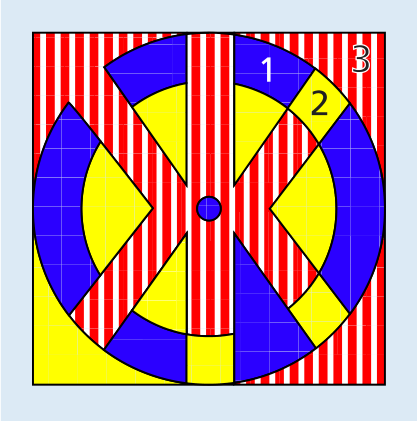
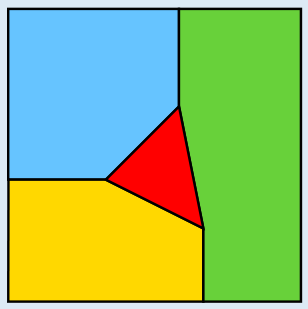

3 ist die richtige Antwort: Hier ist ein Beispiel, wie man mit drei verschiedenen Farben das Bild bunt einfärben kann, so dass alle Flächen, die nebeneinander liegen, verschiedene Farben haben. Die große Fläche mit der Ecke oben links und alle anderen Flächen, die nicht daneben liegen (nämlich die Ecken oben und unten rechts), wurden rot(-weiß) gefärbt. Dann wurden die Flächen im Kreis so weit wie möglich blau gefärbt, wieder von links oben aus. Alle restlichen Flächen wurden gelb gefärbt.

Mit weniger Farben geht es nicht. Schauen wir uns die Flächen 1, 2 und 3 an. 1 und 2 liegen nebeneinander, müssen also verschiedene Farben haben. Beide Flächen liegen jeweils auch neben Fläche 3. Deshalb muss 3 eine andere Farbe als 1 und auch eine andere Farbe als 2 haben. Allein für diese drei Flächen werden also drei verschiedene Farben benötigt.

## Das ist Informatik!

In dieser Biberaufgabe genügen drei Farben, um ein Bild mit Flächen so einzufärben, dass benachbarte Flächen nicht die gleiche Farbe haben. Aber ist das immer so? Die Antwort lautet: Nein; aber man kann immer mit vier Farben auskommen. Hier ist ein Bild, in dem jede Fläche drei Nachbarn hat. Deshalb werden vier Farben benötigt.

Die Frage nach der Farbenzahl stammt aus der Mathematik. Ihre allgemeine Beantwortung war so schwierig und kompliziert, dass Computerprogramme dabei zum Einsatz kamen. Schwierig kann auch das Problem sein, für ein gegebenes Bild, z. B. eine Landkarte, die kleinste Anzahl von Farben zu finden. Das ist schade, denn deshalb sind auch andere Probleme schwierig. Zum Beispiel ist auch die Erstellung eines Stundenplans ein Einfärbungsproblem: Die „Flächen“ sind dann die zu unterrichtenden Stunden, und „Nachbarn“ sind die Stunden, die von der gleichen Lehrkraft oder in der gleichen Klasse unterrichtet werden. Sie dürfen nicht der gleichen „Farbe“, also der gleichen Schulstunde (z. B. Dienstag 4. Stunde) zugeordnet werden.
