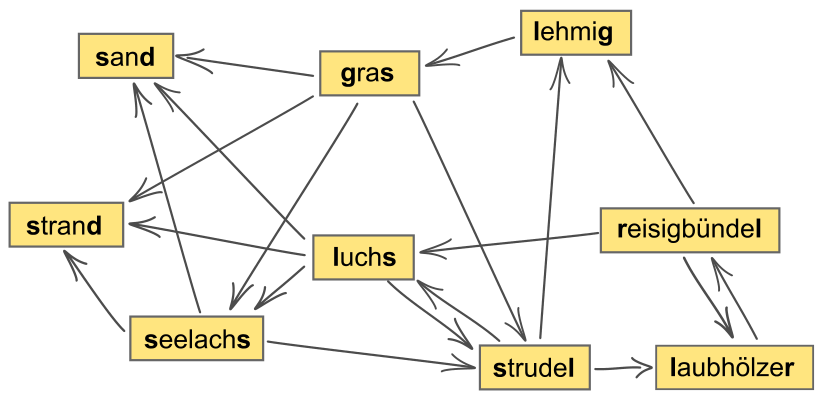

Die Biber spielen „Wörterkette“.

Aus einer Menge von Wörtern wählen sie ein beliebiges Anfangswort aus. Danach verlängern sie nach und nach die Wörterkette um ein Wort, welches mit dem letzten Buchstaben des vorigen Worts beginnt. Jedes Wort darf höchstens einmal verwendet werden.

Heute spielen die Biber mit der Wörtermenge, die im Bild gezeigt ist.

Eine Wörterkette aus dieser Menge ist zum Beispiel: strudel → luchs. Sie besteht aus zwei Wörtern.

**Aus wie vielen Wörtern kann eine Wörterkette aus dieser Menge höchstens bestehen?**
