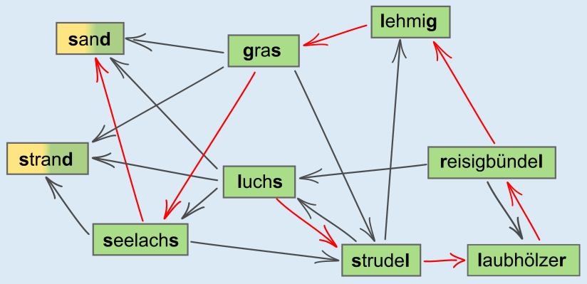

8 ist die richtige Antwort: Das ist eine Wörterkette aus der im Bild gezeigten Menge: luchs → strudel → laubhölzer → reisigbündel → lehmig → gras → seelachs → sand. Sie besteht aus acht Wörtern. Kannst du eine andere Kette aus acht Wörtern finden?

Eine bestimmte Wörterkette aus acht Wörtern anzugeben beweist, dass die Antwort auf die Frage dieser Biberaufgabe mindestens 8 lautet. Da die Wörtermenge neun Wörter enthält, kann eine Wörterkette aus dieser Menge grundsätzlich höchstens aus 9 Wörtern bestehen. Nun betrachten wir die Wörter „sand“ und „strand“. Beide Wörter enden mit „d“. Es gibt aber kein Wort, das mit „d“ beginnt. Also muss eines dieser beiden Wörter das letzte Wort der Kette sein. Da eine Wörterkette nur ein letztes Wort haben kann, kann eines der beiden Wörter nicht verwendet werden. Deshalb kann eine Wörterkette aus dieser Menge höchstens aus acht Wörtern bestehen.

Mit welchem Wort sollte man am besten beginnen, um eine Wörterkette aus möglichst vielen Wörtern zu bilden? Vielleicht ist dir aufgefallen, dass drei Wörter mit „l“ beginnen, aber nur zwei Wörter auf „l“ enden. Damit man alle drei Wörter mit „l“ am Anfang auch verwenden kann, sollte man also mit einem von ihnen beginnen. Das Bild zeigt die oben angegebene Wörterkette. Gestartet wird bei „luchs“, und dann folgt man den roten Pfeilen. Das letzte Wort könnte auch „strand“ sein statt „sand“.

## Das ist Informatik!

In dieser Biberaufgabe wird eine Beziehung zwischen den Elementen einer Menge betrachtet, nämlich die zwischen Wörtern mit übereinstimmenden End- und Anfangsbuchstaben. Eine solche Beziehung kann gut als Graph modelliert und, wie im Bild in der Aufgabe, durch Linien zwischen den Elementen veranschaulicht werden. Hier ist der Graph gerichtet und wird deshalb mit Pfeilen dargestellt. Die Beziehung zwischen den Wörtern hat nämlich eine Richtung: Man kann von „gras“ zu „sand“ gehen, aber nicht umgekehrt.

Für viele Probleme, die mit Graphen modelliert werden können, kennt die Informatik gute Lösungen. Aber es gibt auch Gegenbeispiele: In der Sprache der Graphen ist die längste Wörterkette der längste Weg, den man über die Pfeile des Wörter-Graphen gehen kann. Im Allgemeinen gehört das Finden eines längsten Weges zu den schwierigsten Graphen-Problemen und zu den schwierigsten Problemen, die die Informatik überhaupt kennt.
