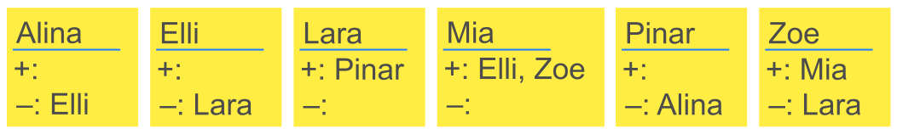

Die „Hacking Girls“, ein Computer-Club für Mädchen, planen einen Ausflug mit Übernachtung. Die Jugendherberge hat große Mehrbettzimmer. Aber wer soll mit wem auf ein Zimmer?

Jedes Clubmitglied schreibt auf eine Wunsch-Karte,

- mit welchen Mädchen sie unbedingt (+) und
- mit welchen Mädchen sie absolut nicht (–)

im gleichen Zimmer sein möchte.

Die Club-Vorsitzende muss die Mädchen auf die Zimmer verteilen. Sie will alle Zimmer-Wünsche erfüllen.

**Hilf ihr und verteile die Mädchen auf die Zimmer!**

Ordne dazu jedes Mädchen einem der drei Zimmer zu, so dass alle Wünsche erfüllt werden. Zum Glück ist das möglich. (Im Informatik-Biber 2018 wurde diese Aufgabe mit teils anderen Namen verwendet.)
