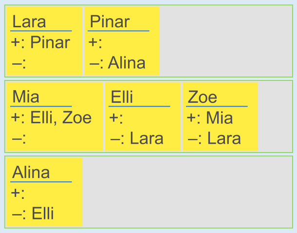

Wenn genügend Zimmer vorhanden sind, genügt es, sich auf die positiven Wünsche zu konzentrieren. Das geht so: Für jedes Mädchen M suchen wir ein Zimmer (also: ein Rechteck) mit mindestens einer Wunsch-Karte eines anderen Mädchens M2, so dass M2 auf der Liste „+“ von M oder M auf der Liste „+“ von M2 steht. Gibt es so ein Zimmer, dann ziehen wir die Karte von M auf das Zimmer; sonst ziehen wir die Karte auf ein leeres Zimmer.

Jetzt sind alle positiven Wünsche erfüllt. Aber es kann sein, dass wir dabei negative Wünsche verletzt haben. Das müssen wir prüfen: Gibt es ein Zimmer mit einer Karte, die auf der Liste „–“ einer anderen Karte im gleichen Zimmer steht, lassen sich nicht alle Wünsche erfüllen.

Zum Glück ist es möglich, alle Wünsche zu erfüllen. Auf die oben beschriebene Weise erhalten wir die abgebildete Zimmerverteilung (die Reihenfolge der Zimmer spielt keine Rolle). Diese ist die einzige Verteilung, die alle Wünsche erfüllt: Lara muss mit Pinar im gleichen Zimmer sein. Aber Lara (und damit auch Pinar) kann weder mit Elli noch mit Zoe im gleichen Zimmer sein, und damit auch nicht mit Mia, die wiederum mit Elli und Zoe zusammen sein muss. Alina muss in ein eigenes Zimmer, da sie weder mit Pinar (und damit auch Lara) noch mit Elli (und damit auch Mia und Zoe) zusammen sein kann.

Es kann natürlich leicht passieren, dass nicht alle Wünsche erfüllbar sind. Wenn z. B. Lara unbedingt mit Pinar, aber Pinar absolut nicht mit Lara im gleichen Zimmer sein möchte, lassen sich diese beiden Wünsche nicht gleichzeitig erfüllen.

## Das ist Informatik!

Die Club-Vorsitzende hat ein Problem: Sie sucht nach einer Zimmerverteilung, die alle Wünsche erfüllt. Solch eine Verteilung ist eine „Lösung“ ihres Problems. Aber wie kann sie diese Lösung finden? Eine einfache Möglichkeit: Sie verteilt die Mädchen auf alle möglichen Weisen auf die Zimmer, ohne auf die Wünsche zu achten, und betrachtet dann jede fertige Verteilung, ob sie alle Wünsche erfüllt. Wenn die Gruppe größer ist, kann es aber ziemlich viele Verteilungen geben; diese Methode kostet dann viel Zeit. Es geht schneller, wenn man die durch die Wünsche der Mädchen gegebenen Bedingungen an die Verteilung von vornherein berücksichtigt und nur solche Verteilungen erzeugt, die alle Bedingungen erfüllen und deshalb Lösungen sind.

Probleme, bei denen Bedingungen erfüllt werden müssen, um zu einer Lösung zu kommen, werden auch „Constraint-Satisfaction-Probleme“ genannt und treten in der Informatik häufig auf. Dabei geht es wie in dieser Biberaufgabe häufig darum, dass bestimmte Dinge (auch „Ressourcen“ genannt) ohne Konflikt benutzt werden sollen, wie etwa die Start- und Landebahnen eines Flughafens. Die Informatik kennt Verfahren, mit denen die meisten solcher Probleme effizient gelöst werden können.
