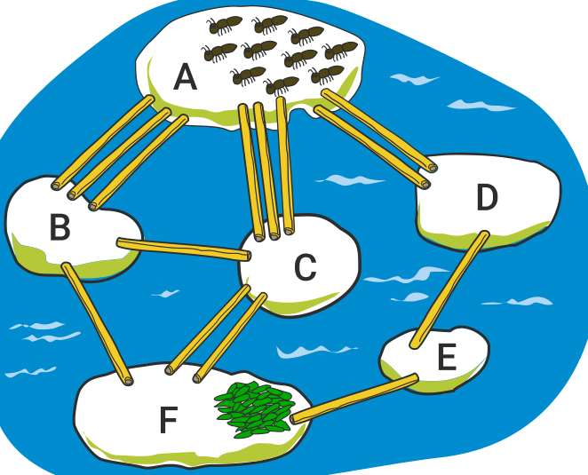

Zehn Ameisen sind auf Stein A. Sie wollen zum Stein F, dort gibt es Futter. Die Ameisen können über die Strohhalme zu den anderen Steinen laufen. Aber jeder Strohhalm kann höchstens eine Ameise gleichzeitig tragen. Eine Ameise braucht eine Minute, um von einem Stein über einen Strohhalm zum nächsten Stein zu laufen.

**Wie viele Ameisen können nach drei Minuten höchstens beim Futter auf Stein F sein?**
