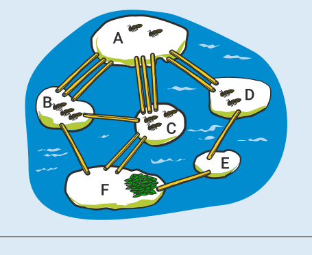
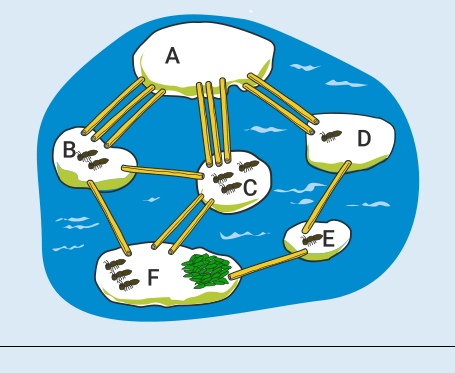
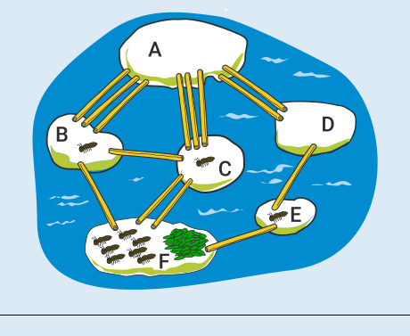

**7** ist die richtige Antwort. Die Bilder zeigen, wie viele Ameisen nach ein, zwei bzw. drei Minuten höchstens über die Strohhalme gelaufen sein können:

| nach einer Minute | nach zwei Minuten | nach drei Minuten |
|---|---|---|
|  |  |  |

## Das ist Informatik!

Die Frage in dieser Biberaufgabe lässt sich auch als Auftrag formulieren: Bestimme die größte Zahl an Ameisen, die nach 3 Minuten beim Futter sein können. Es gibt viele Möglichkeiten, wie die Ameisen über die Strohhalme laufen können. Zur Bearbeitung dieses Auftrags werden sie allein nach einem Merkmal oder Kriterium unterschieden, nämlich nach der Anzahl der Ameisen, die nach 3 Minuten beim Futter sind. Bezüglich dieses Kriteriums wird die beste, also optimale Möglichkeit gesucht. Der Auftrag entpuppt sich also als Optimierungsaufgabe, mit dem schon genannten Optimierungskriterium.

Die Informatik beschäftigt sich intensiv mit vielerlei verschiedenen Optimierungsaufgaben. Eine Optimierungsaufgabe ist, den maximalen Fluss von Mengen (zum Beispiel Güter, Verkehrsteilnehmer, Wasser, …) durch Netzwerke (zum Beispiel Eisenbahn- oder Straßenverbindungen, Leitungssysteme, …). Dabei können die einzelnen Verbindungen der Netzwerke (Schienenstrecken, Straßen, Leitungen, …) unterschiedliche Kapazitäten haben. Auch die Strohhalme in dieser Biberaufgabe bilden ein Fluss-Netzwerk, mit einzelnen Verbindungen zwischen zwei Steinen und der Anzahl der Strohhalme als Kapazitäten. Die Menge, deren Fluss zu optimieren ist, sind die Ameisen. Du hast hier also ein ganz spezielles Fluss-Problem gelöst.
