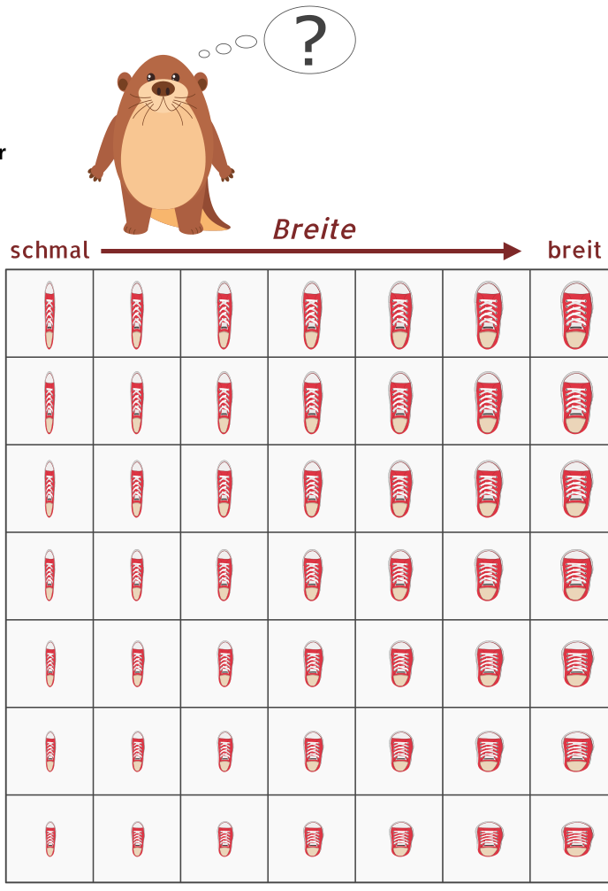

Der Biber braucht neue Schuhe. Im Geschäft gibt es seine Lieblingsschuhe in sieben Längen und sieben Breiten. Schuhe in allen 49 Größen sind im Regal, nach Länge und Breite sortiert.

Weil der Biber die richtige Größe nicht weiß, muss er sie durch Anprobieren herausfinden. Bei jeder Anprobe merkt der Biber, ob der Schuh passt oder ob er einen kürzeren, längeren, schmaleren oder breiteren Schuh braucht. Länge und Breite müssen stimmen!

Der Verkäufer stöhnt: Bei 49 Größen die richtige zu finden – das kann dauern.

Doch dem schlauen Biber ist die schnellste Methode eingefallen, die richtige Größe in jedem Fall nach möglichst wenigen Anproben zu wissen.

**Wie viele Anproben braucht er mit der schnellsten Methode höchstens, bis er die richtige Größe weiß?**
