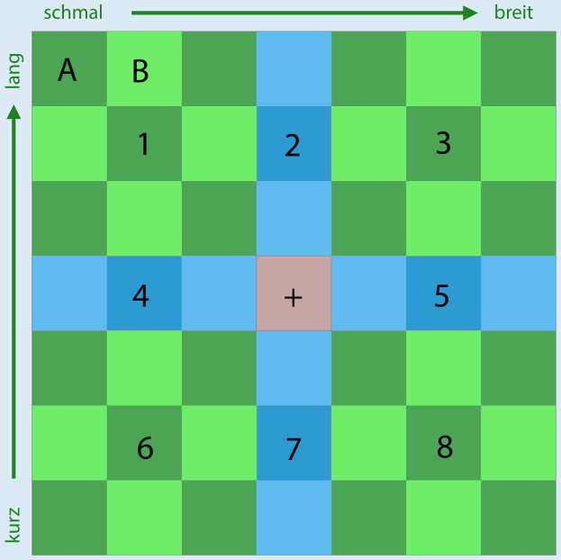

**2** ist die richtige Antwort.

Natürlich kann der Biber Glück haben und direkt bei der ersten Anprobe den Schuh in der richtigen Größe erwischen. Aber auf Glück will er sich nicht verlassen und geht nach dieser Methode vor:

Zuerst probiert er den Schuh in der Mitte an (Position + im Bild). Bei der Anprobe prüft er Länge und Breite des Schuhs.

- Wenn Länge und Breite stimmen, hat er den Schuh mit der richtigen Größe gefunden.
- Wenn der Schuh zu kurz und zu breit ist, ist der passende Schuh in Bereich 1.
- Wenn der Schuh zu kurz ist, aber die richtige Breite hat, ist der passende Schuh in Bereich 2.
- Wenn der Schuh zu kurz und zu schmal ist, ist der passende Schuh in Bereich 3.
- Und so weiter.

Nehmen wir an, der Schuh mit der richtigen Größe ist in Bereich 1. Der Biber wählt für die zweite Anprobe den Schuh in der Mitte von Bereich 1.

Nun gibt es wieder mehrere Möglichkeiten: Wenn der Schuh passt, hat er die richtige Größe gefunden.

- Wenn der Schuh immer noch zu kurz und zu breit ist, weiß der Biber, dass der Schuh an Position A die richtige Größe hat.
- Wenn der Schuh zu kurz ist, aber die passende Breite hat, weiß der Biber, dass der Schuh an Position B die richtige Größe hat.
- Und so weiter.

Weil in jedem nummerierten Bereich das mittlere Regalfach in jeder Richtung nur ein Nachbarfach hat, sind keine weiteren Anproben notwendig. Der Biber braucht also in jedem Fall höchstens zwei Anproben, um die richtige Größe zu wissen.

## Das ist Informatik!

Die Methode, die der Biber bei der Anprobe anwendet, heißt in der Informatik binäre Suche. Der Begriff binär kommt vom lateinischen Wort bis (zweimal). Bei der binären Suche nach einem Objekt in einer Folge sortierter Objekte wird deren mittleres Objekt mit dem gesuchten verglichen. Dann weiß man, in welcher Hälfte der Folge sich das gesuchte Objekt befindet und durchsucht diese Hälfte wieder binär. In jedem Schritt wird die Folge also in zwei Teile geteilt – deshalb „binär“. Auf diese Weise kommt man sehr schnell beim gesuchten Objekt an. Bei 1.000 Objekten werden etwa 10 Suchschritte benötigt, bei 1.000.000 Objekten etwa 20. Allgemein kann man sagen: Bei n Objekten werden etwa log n Schritte benötigt; die Funktion log ist der „Zweier-Logarithmus“.

In dieser Biberaufgabe ist die Suchfolge, nämlich die Schuhe im Regal, in zwei Dimensionen (Länge und Breite) sortiert. Deshalb kann der Biber die binäre Suche gleich auf beide Dimensionen anwenden. Dann teilt sich die Suchmenge in einem Schritt nicht in 2, sondern gleich in 8 Teile auf.

Weil die binäre Suche so schnell ist, wird sie in Computerprogrammen häufig für die Suche in sortierten Daten verwendet.
