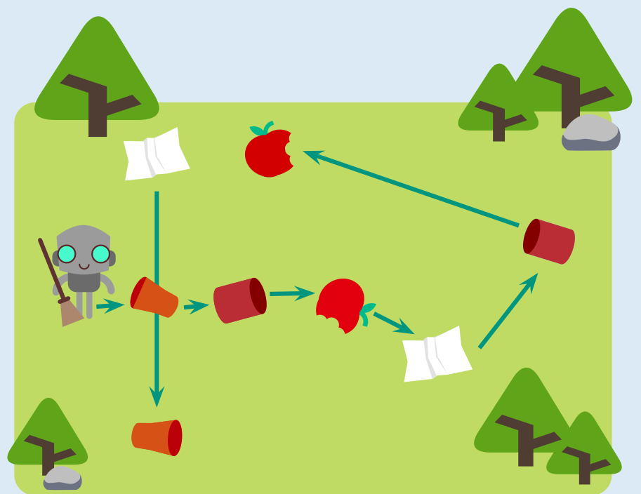

Das Bild zeigt den Weg, den der Roboter beim Müllsammeln geht. Als letztes sammelt er den Becher unten links auf.

## Das ist Informatik!

Das Verhalten des Roboters wird durch ein Computerprogramm gesteuert. Das Programm wird auf einem Computer ausgeführt, der in den Roboter eingebaut ist. Ein Computerprogramm besteht aus Befehlen, die in einer Sprache geschrieben sind, die der Computer versteht. Ein Roboter hat Kameras und Sensoren, mit denen er Dinge in seiner Umgebung wahrnehmen und die Entfernung zu diesen Dingen berechnen kann. Das Programm für den Computer des Roboters verarbeitet die Daten der Sensoren und ermöglicht, dass der Roboter sich autonom bewegen kann. Das heißt, er muss nicht von einem Menschen ferngesteuert werden.

Der Müllsammelroboter in der Aufgabe hat einen ziemlich harmlosen Job. Aber ein Roboter kann auch Arbeiten erledigen, die für Menschen gefährlich sind. Roboter können nach einer Katastrophe nach Überlebenden suchen oder giftige oder radioaktive Materialien einsammeln.
