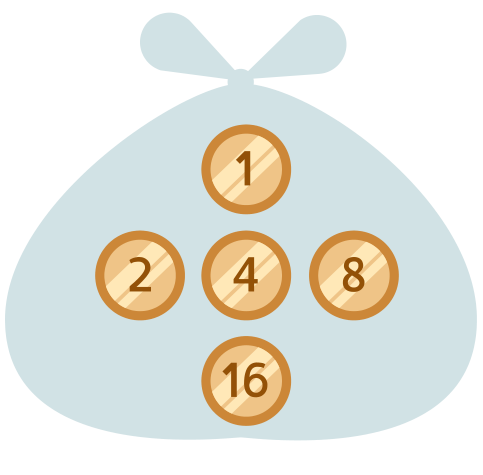

Bibertaler gibt es nur als Münzen, und zwar 1, 2, 4, 8 und 16 Bibertaler. Die Biber bezahlen immer den genauen Betrag, mit so wenigen Münzen wie möglich. Ein Biber kauft Holz und muss 13 Bibertaler bezahlen.

**Mit welchen Münzen bezahlt der Biber?** Wähle die Münzen aus.
