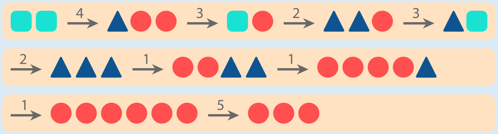

Auf den ersten Blick sind die Knöpfe 1 und 2 verführerisch. Mit ihnen lassen sich reichlich Kreise produzieren – aber leider nur genau acht, und aus denen lassen sich mit Knopf 5 nur fünf und zwei Kreise produzieren. Zu einer Lösung kommt man, wenn man vom Ziel her denkt: Drei Kreise lassen sich mit Knopf 1 aus sechs Kreisen produzieren. Sechs Kreise wiederum lassen sich mit Knopf 1 aus drei Dreiecken produzieren. Diese wiederum lassen sich aus den zu Beginn vorhandenen zwei Quadraten durch diese Knopffolge produzieren: 4, 3, 2, 3, 2.

Insgesamt kommt man also so zum Ziel:

## Das ist Informatik!

Zur Beantwortung dieser Biberaufgabe muss Folgendes herausgefunden werden: Gibt es, ausgehend von den Startsymbolen (den zwei Quadraten) eine Folge von Ersetzungen, die zu den Zielsymbolen (den drei Kreisen) führt?

Formen bzw. Symbole und Ersetzungen bilden zusammen ein Ersetzungssystem. In der theoretischen Informatik werden solche Ersetzungssysteme unter bestimmten Bedingungen auch als Grammatiken bezeichnet. Die Symbolfolgen, die, wie hier im Formenspiel, durch Anwendung der Ersetzungen (die Informatik spricht auch von Regeln) einer Grammatik erzeugt werden können, sind dann die Wörter einer Sprache. Für jede Grammatik und die durch sie erzeugte Sprache lässt sich das Wortproblem als Frage formulieren: Gehört ein gegebenes Wort zu der von der Grammatik erzeugten Sprache? Genau diese Frage haben wir oben für die drei Kreise gestellt.

Auch in der Praxis der Informatik spielt das Wortproblem eine wichtige Rolle. Zum Beispiel werden Programmiersprachen durch Grammatiken beschrieben. Ein Wort der (Programmier)Sprache ist dann ein Programm-Quellcode, der keine syntaktischen bzw. strukturellen Fehler mehr hat: alle Kommata oder Semikolons, alle Klammern, alle mathematischen oder anderen Zeichen und so weiter sitzen an der richtigen Stelle. Bevor ein Compiler den Quellcode in ein ausführbares Programm übersetzen kann, muss er zunächst prüfen, ob der Quellcode syntaktisch korrekt ist – er muss also das Wortproblem lösen.
