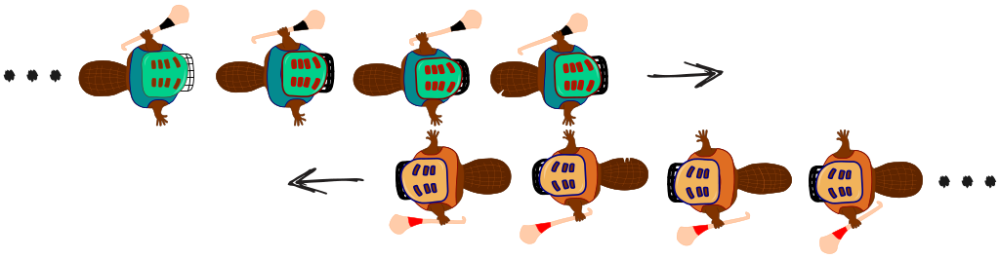

Biber spielen gerne das irische Spiel Hurling.

Am Schluss einer Partie Hurling stellen sich die Teams gegenüber auf, jeweils in einer Reihe. Dann gehen die Teams aneinander vorbei, schütteln sich nach und nach die Hände und sagen „Danke für das Spiel!“.

Das Händeschütteln geht so: Die Teams gehen um einen Spieler vor, so dass die ersten Spieler beieinander stehen und sich die Hände schütteln. Dann gehen die Teams wieder um einen Spieler vor, so dass die ersten Spieler und die zweiten Spieler beieinander stehen und sich die Hände schütteln (siehe Bild). Dies geht so weiter, bis auch die beiden letzten Spieler sich die Hände geschüttelt haben.

Beim Hurling gibt es 15 Spieler pro Team. Dass die Teams um einen Spieler vor gehen und sich alle Spieler, die beieinander stehen, die Hände schütteln, dauert 1 Sekunde.

**Wie viele Sekunden dauert das Händeschütteln der beiden Teams insgesamt?**
