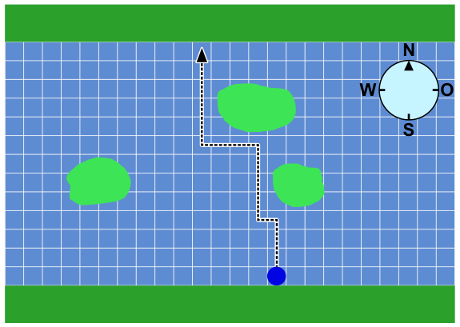

Ein autonomes Boot fährt vom Südufer des Flusses zum Nordufer. Dabei muss es die Inseln im Fluss umfahren.

Die digitale Landkarte des Boots ist in Quadrate eingeteilt. Das autonome Boot fährt immer von einem Quadrat zum nächsten Quadrat im Norden oder Westen. Es kann nur dann zum nächsten Quadrat fahren, wenn dieses völlig frei und nicht zum Teil von einer Insel belegt ist.

Das autonome Boot fährt also nach diesen Anweisungen:

Piraten haben eine künstliche Insel angelegt, als Falle für das autonome Boot. Das heißt: Je nachdem, wie sich das Boot der Insel nähert, kann es passieren, dass es stehen bleibt und nicht weiterfahren kann. Es ist gefangen.

**Welche dieser Inseln ist eine Falle für das autonome Boot?**
