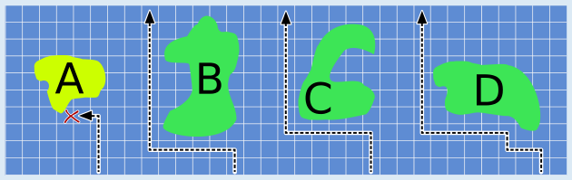
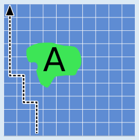

**Antwort A** ist richtig.

Wenn das autonome Boot Insel A auf der rechten Seite erreicht (wie im Bild links), weicht es zunächst nach Westen aus und bleibt dann stehen, ohne das Nordufer des Flusses zu erreichen. Es steckt in der Falle. Der Grund: Es kann weder nach Westen noch nach Norden weiterfahren, und für andere Bewegungsrichtungen gibt es keine Anweisungen. Wenn es von einem anderen Startpunkt – wie im Bild rechts – losfährt, wird es von der Insel A nicht gefangen.

Die anderen Inseln sind keine Gefahr für das autonome Boot. An den Südufern dieser Inseln gibt es kein freies Quadrat, dessen westliches *und* nördliches Nachbarquadrat belegt ist. Wenn ein autonomes Boot sich von Süden einer dieser Inseln nähert, kann es immer nach Westen ausweichen und die Insel umfahren.

## Das ist Informatik!

Die Steuerung des autonomen Boots wurde mit einem Flussdiagramm beschrieben. Ein Flussdiagramm (oder Programmablaufplan, PAP) definiert einen Algorithmus oder Arbeitsablauf. Die Rechtecke des Flussdiagramms enthalten Anweisungen. Die Rauten enthalten jeweils einen Test, d. h. eine Frage, die mit Ja oder Nein beantwortet werden kann. Die Pfeile zeigen an, in welcher Reihenfolge die Anweisungen ausgeführt werden. Die Ovale zeigen Start und Ende des Ablaufs an.

Die Steuerung des autonomen Boots funktionierte perfekt mit den natürlichen rund geformten Inseln des Flusses. Allerdings berücksichtigte der Algorithmus nicht, dass Inseln auch anders geformt sein können und unter bestimmten Bedingungen das autonome Boot an einer Insel anhalten muss und das Nordufer nicht erreichen kann. Das ist eine Schwäche dieses Algorithmus, eine Sicherheitslücke, die von den Piraten ausgenutzt wurde.

Informatikerinnen und Informatiker versuchen Software zu entwickeln, die unter allen denkbaren Bedingungen richtig funktioniert. Interaktive Webseiten zum Beispiel, die Eingabefelder enthalten, prüfen die eingegebenen Texte sorgfältig und weisen Texte zurück, die für den Computer gefährlich sein könnten, z. B. schädliche Skripte (Code Injection).
