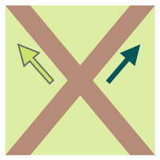
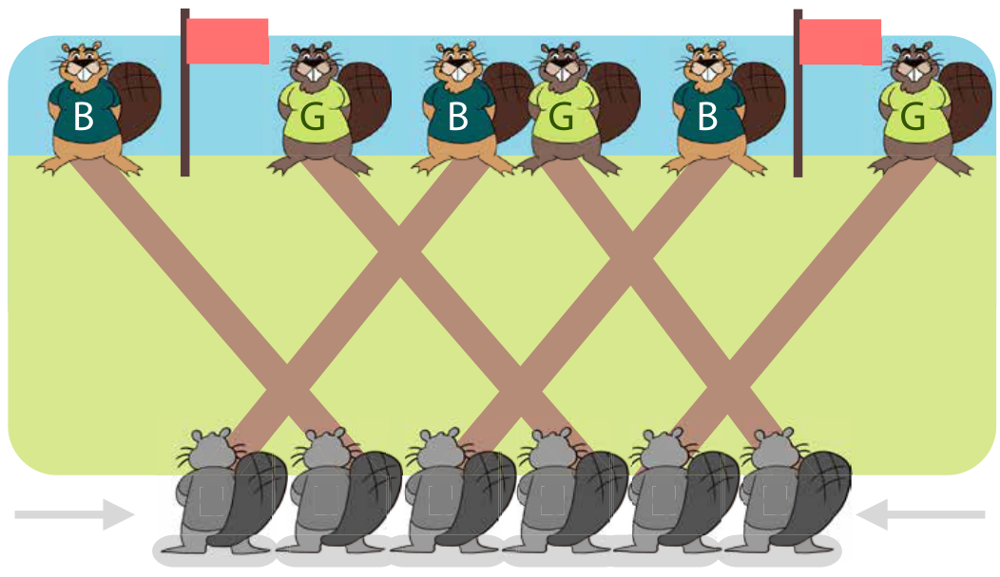

Die blauen und die grünen Biber haben zusammen ein Kanalsystem gebaut. Es hat sechs Eingänge (unten) und sechs Ausgänge (oben), und es gibt Kreuzungen.

Für die Kreuzungen gibt es eine Regel: Wenn sich ein grüner und ein blauer Biber treffen, schwimmt der grüne nach links und der blaue nach rechts.

Drei blaue und drei grüne Biber schwimmen gleichzeitig an den Eingängen los.

An den Ausgängen sollen sie so ankommen (von links nach rechts, B = blau und G = grün): B G B G B G

**Wie müssen sie an den Eingängen los schwimmen?** Wähle die Farben der Biber von links nach rechts.
