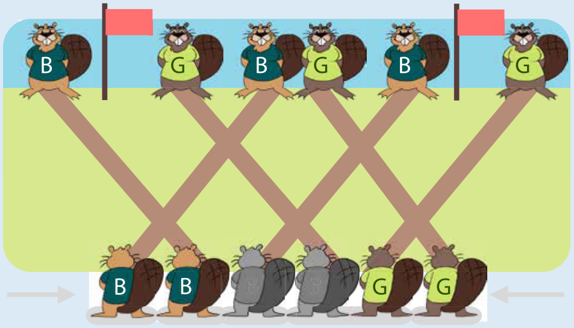
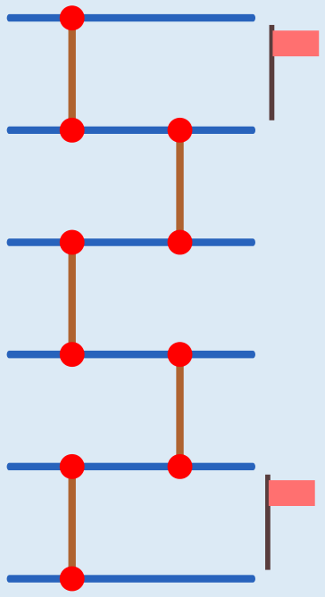

---
answers:
  - [B, B, B, G, G, G]
  - [B, B, G, B, G, G]
---
Damit am linken Ausgang ein blauer Biber ankommen kann, müssen an den beiden linken Eingängen zwei blaue Biber los schwimmen. Ansonsten würde nämlich ein grüner Biber ganz links ankommen. Damit am rechten Ausgang ein grüner Biber ankommen kann, müssen an den beiden rechten Eingängen zwei grüne Biber los schwimmen. Ansonsten würde nämlich ein blauer Biber ganz rechts ankommen.

An den mittleren beiden Eingängen spielt die Farbe keine Rolle: Egal, an welchem der dritte blaue und der dritte grüne Biber los schwimmt, schwimmt nach der ersten Kreuzung der grüne Biber links und der blaue Biber rechts weiter. Und dann kommen die Biber an den Ausgängen so an wie vorgegeben. Welcher der beiden Biber an den mittleren Eingängen blau und welcher grün ist, ist also gleich.

Die beiden richtigen Antworten sind also **Blau, Blau, Blau, Grün, Grün, Grün** und **Blau, Blau, Grün, Blau, Grün, Grün**.

## Das ist Informatik!

Computer verarbeiten Daten – häufig sehr viele Daten. Dabei ist es wichtig, dass in den Daten Ordnung herrscht. In der Informatik sagt man statt ordnen meist sortieren: Zum Beispiel können Zahlen nach aufsteigender Größe, Daten über Personen nach dem Geburtsdatum oder Daten über Bücher nach der ISBN-Nummer sortiert werden. Am Ende eines Sortiervorgangs stehen die Daten in der gewünschten Reihenfolge.

Die wichtigste Operation beim Sortieren ist der „Swap“: Daten an zwei Positionen in der Reihenfolge werden miteinander verglichen. Ist ihre Sortierung untereinander richtig, bleiben sie stehen, sonst werden sie vertauscht. Genau das passiert in dieser Biberaufgabe an den Kreuzungen des Kanalsystems.

Das Kanalsystem der Biber funktioniert nämlich wie ein Teil eines Sortiernetzes. In einem Sortiernetz wandern Daten entlang von Linien (hier: die Kanäle), die an manchen Stellen paarweise miteinander verbunden sind (hier: die Kreuzungen). Bei einer Verbindung wird geprüft, ob die Daten der beiden Linien getauscht werden sollen.

Mehr Biberaufgaben mit Sortiernetzen findest du in den Biberheften von 2011 („Sortierende Brücken“), 2014 („Pfützenspringen“) und 2018 („Büchertausch“). Zum Thema Sortieren gibt es in diesem Biberheft noch die Aufgaben „Anproben“, „Teller-Ordnung“ und „Türme“.
