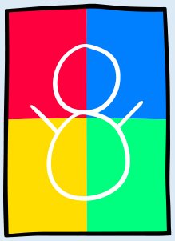
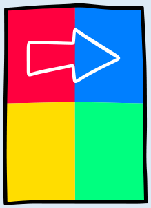
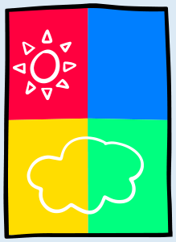
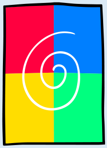

**Antwort C** ist richtig. So liegen die Bilder über den bunten Farben:

| A) | B) | C) | D) |
|---|---|---|---|
|  |  |  |  |
| 4 Farben | 3 Farben | 3 Farben | 4 Farben |

Nur bei Bild C können die Biber genau 3 Farben sehen.

## Das ist Informatik!

Die Kratzbilder bestehen aus zwei Schichten, nämlich aus der Schicht mit den bunten Farben und der schwarzen Schicht darüber. Um die Anzahl der Farben zu ermitteln, muss man genau wissen, wo die Farben auf der unteren Schicht unter der schwarzen Schicht versteckt sind.

Wer am Computer Bilder macht, kann dabei auch Schichten (die oft auch Ebenen heißen) übereinander legen – wie beim Kratzpapier in dieser Biberaufgabe. So kann man den Hintergrund eines Bildes (zum Beispiel die Grashalme einer Wiese) und die Dinge, die vor dem Hintergrund erscheinen sollen (zum Beispiel verschiedene Blumen) auf unterschiedliche Schichten malen – und dann die Schicht mit dem Hintergrund in einem anderen Bild gleich noch einmal verwenden. Am Computer-Bildschirm können die Schichten sogar gemischt werden. Dazu muss man festlegen, dass die oberste Schicht halb durchsichtig (transparent) sein soll, wie etwa eine farbige Folie.
