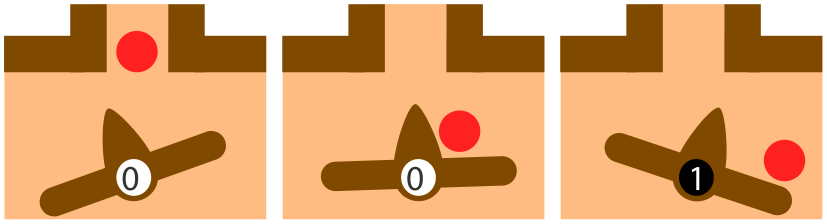
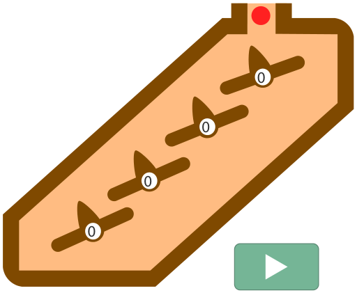

Eine Kugelbahn hat vier Wippen. Jede Wippe kann auf zwei Positionen stehen:

- Ist die Wippe nach links geneigt, steht sie auf Position 0.
- Ist die Wippe nach rechts geneigt, steht sie auf Position 1.

Wenn eine Kugel auf eine Wippe trifft, ändert die Wippe ihre Position und die Kugel rollt weiter, wie die drei Bilder zeigen: Eine Wippe auf 0 kippt auf 1, und die Kugel rollt nach rechts weiter.

Hier ist eine Animation der Kugelbahn. Zu Beginn stehen alle Wippen auf Position 0; die Wippen zeigen insgesamt also: 0000. Dann rollen nacheinander zwei Kugeln. Danach zeigen die Wippen: 0010.

Die Kugelbahn wird zurückgesetzt, und die Wippen zeigen wieder 0000. Nun rollen nacheinander fünf Kugeln.

**Was zeigen die Wippen jetzt?**
