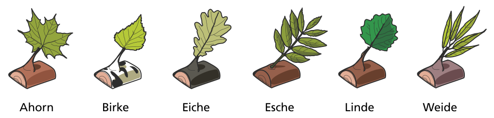

Ben veranstaltet eine Party für sich und seine sechs Biber-Freunde, mit viel leckerem Holz!

Leider haben alle sieben Biber einen eigenen Geschmack:

| Dieser Biber … | … findet diese Holzsorten lecker: |
|---|---|
| Anne | Ahorn, Eiche, Esche, Weide |
| Ben | Eiche, Linde, Weide |
| Carlo | Eiche |
| Doris | Birke, Esche |
| Emre | Ahorn, Birke, Weide |
| Freddy | Eiche, Esche |
| Georg | Ahorn, Linde |

Ben möchte sich Arbeit sparen und möglichst wenige Holzsorten besorgen. Aber natürlich möchte er für jeden Biber eine leckere Sorte haben.

**Wie viele Holzsorten muss Ben mindestens besorgen?**
