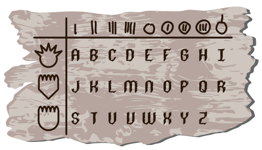
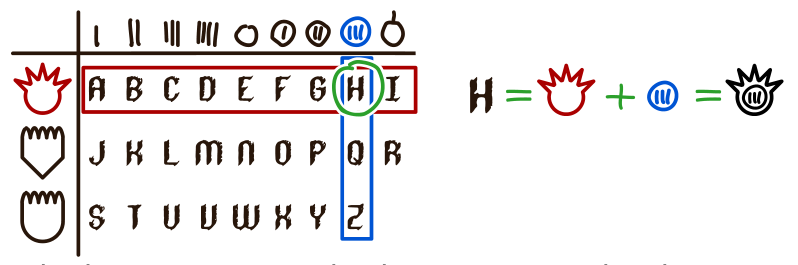
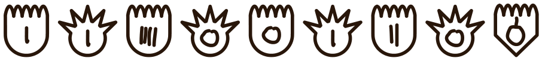

Am Biberdamm findet Lena ein Stück Holz. Darin sind Zeichen und Buchstaben eingeritzt und in einer Tabelle angeordnet. Lena überlegt sich, dass sie mit Hilfe der Tabelle Nachrichten kodieren kann.

Jeder Buchstabe wird durch eine Kombination aus zwei Zeichen kodiert. Ein Beispiel: Das H steht in der ersten Reihe in der achten Spalte. Es wird also durch das Zeichen der ersten Reihe und das Zeichen der achten Spalte kodiert.

Lena kodiert nun eine Nachricht aus neun Buchstaben mit Hilfe der Tabelle:

**Wie lautet Lenas Nachricht?**
