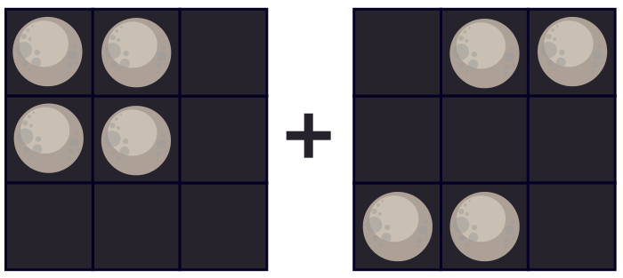

Der weise Anaxagoras besitzt Mondzauberkarten, die für jedes ihrer neun Felder nach einer festen Regel funktionieren. Bei zwei Karten gibt er in jedes Feld ein Mondsymbol ein: Neumond (schwarz) oder Vollmond. Sofort erscheinen auch Mondsymbole auf einer dritten Karte.

Hier ein Beispiel, links die zwei Eingabekarten, rechts die Ausgabekarte:

Verstehst du die Regel? Dann gib die Ausgabekarte für diese beiden Eingabekarten ein:

**Klicke auf die Felder der Ausgabekarte, bis alle das richtige Mondsymbol zeigen.** Dunkel ist Neumond, hell ist Vollmond.
