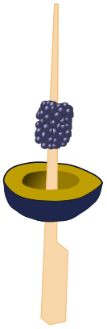
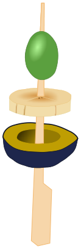

Bei Leos Party gibt es Obstspieße. Dafür stehen sechs Obstsorten zur Auswahl. Die Sorten haben die Nummern 1 bis 6. Die Tabelle zeigt, welche Obstsorten für die ersten vier Spieße gewählt wurden.

| Spieß |  |  |  |  |
|---|:-:|:-:|:-:|:-:|
| Obstsorten | 3, 6 | 1, 2, 5 | 2, 5, 6 | 2, 3, 4 |

Leo wählt für seinen Spieß die Obstsorten 1, 5 und 6.

**Welcher ist Leos Spieß?**
