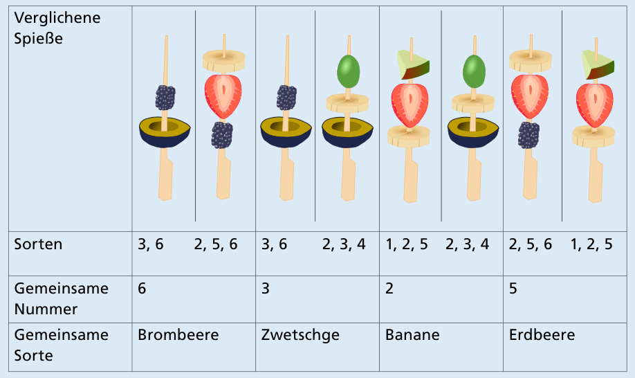
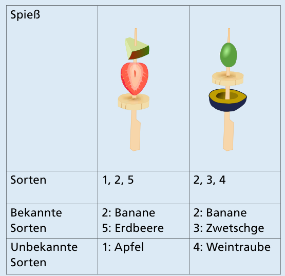

**Antwort A** ist richtig.

Um herauszufinden, welche Nummer zu welcher Obstsorte gehört, kann man die Spieße paarweise miteinander vergleichen. Zum Glück haben sie immer nur eine gemeinsame Sorte:

Jetzt sind nur noch die Sorten 1 und 4 herauszufinden. Dazu kann man sich die zwei Spieße ansehen, die genau eine dieser Sorten enthalten – alle anderen Sorten sind also schon bekannt.

Nun ist für alle Nummern bekannt, zu welcher Obstsorte sie gehören. Leo hat für seinen Spieß also Apfel, Erdbeere und Brombeere gewählt. Das ist Spieß A.

## Das ist Informatik!

Obstsorten und Nummern sollen eindeutig einander zugeordnet werden. Es sollen also Paare entstehen, bei denen jede Sorte bzw. jede Nummer wirklich nur genau einen „Partner“ hat. Als Ausgangspunkt sind für jede Obstsorte anhand der Obstspieße einige Nummern bekannt, die als Partner in Frage kommen. Das ähnelt sehr dem „Heiratsproblem“: Dabei gibt es einige Frauen und einige Männer (nicht unbedingt gleich viele). Für jede Frau ist bekannt, welche Männer sie sich als Ehemann vorstellen kann, und zwar mindestens einen. Dann wird nach einer eindeutigen Zuordnung (wie oben) gesucht, bei der jeder Frau einer ihrer Wunschkandidaten zugeordnet wird. In der Informatik spricht man von einem „Matching“ – und zwar auch dann, wenn es nicht um Frauen und Männer geht. Bei Obstsorten und Nummern wird in dieser Biberaufgabe sogar ein „perfektes Matching“ gesucht, bei dem jede Sorte eine Nummer abbekommt und umgekehrt. Dazu muss es natürlich genau so viele Nummern wie Sorten geben.

Übrigens: In den USA erhalten Medizinstudenten per Matching-Algorithmus eine Stelle zur Facharztausbildung.

https://algo.rwth-aachen.de/~algorithmus/algo22.php  
https://de.wikipedia.org/wiki/Stable_Marriage_Problem
