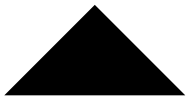

Rangoli sind kunstvolle Bodenmuster. Man kann sie zum Beispiel mit bunten Fliesen legen. Indu hat drei verschiedene Sorten Fliesen: 8 lila Dreiecke, 4 grüne Quadrate und 6 schwarze Dreiecke.

| Sorte |  |  |  |
|---|:-:|:-:|:-:|
| Anzahl | 8 | 4 | 6 |

Indu möchte mit ihren Fliesen ein Rangoli legen. Sie muss aber nicht alle Fliesen benutzen.

**Welches Rangoli kann Indu mit ihren Fliesen legen?**
